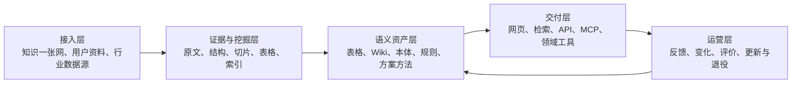
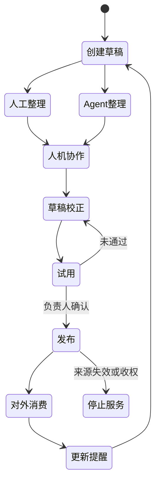

# 产业知识底座：面向产业的知识构建、维护、应用与演进

> 版本：V1.0  
> 日期：2026-09-24  
> 面向对象：产业业务负责人、领域专家、知识建设团队和产业 Agent 团队  
> 用途：从业务视角说明知识底座为什么建设、怎样构建知识、怎样维护知识、怎样让人和 Agent 使用知识，以及后续如何演进

## 一、先说结论

产业知识底座的目标，不是再建设一个通用知识库，也不是把所有资料都做成知识图谱。

它要解决的是一个更实际的问题：**怎样把分散在文档、系统和专家经验中的知识，持续加工成有来源、可维护、能直接支持业务任务的知识资产。**

当前底座已经具备资料管理、文档解析、结构组织、混合检索、章节与表格消费、Agent 接入等主体能力。这些能力解决了“资料能不能进入、能不能找到、能不能读懂”的问题。下一阶段需要进一步解决“业务能不能直接使用、知识变化后能不能维护、使用以后能不能继续变好”的问题。

因此，产业知识底座需要形成一条完整链路：

```text
知识一张网、用户资料、业务数据和专家依据
  → 保留来源、版本、权限和原始证据
  → 解析为可找、可读、可定位的知识视图
  → 围绕具体业务任务整理成知识制品
  → 由专家校准、用真实任务试用并发布
  → 通过网页、检索、MCP和领域工具提供给人和Agent
  → 根据资料变化、任务结果和人工修改持续更新
```

这条链路要同时守住三件事：

1. **能回原文。** 每个关键事实知道来自哪里、使用了哪个版本、当前是否还有权限和效力。
2. **能快速找到。** 人和 Agent 能通过检索、章节、表格和对象关系发现需要的知识。
3. **能直接用于业务。** 高频任务不再每次从零阅读和整理，而是优先使用已经发布的规格矩阵、对象卡、规则、方案方法和场景知识包。

原始资料、检索和知识制品不是相互替代的三条路线。原始资料负责可信，挖掘与检索负责可找可读，知识制品负责业务可用，真实使用反馈负责持续演进。

## 二、为什么产业需要的不只是“能搜索的知识库”

### 1. 一个典型产业问题

以产品硬件资料为例，一个产品目录下可能有几十份结构相似的 HTML 或手册，每份资料描述一个型号。业务人员常见的工作不是查某一句话，而是回答下面这些问题：

- 多个型号的关键规格分别是什么？
- 哪些型号满足某个环境、容量或接口条件？
- 两个版本之间哪些字段发生了变化？
- 某个选型结论依据哪份资料、哪个章节和哪个版本？
- 新手册发布以后，原来的比较结果是否还有效？

如果只依赖文档检索，处理过程通常是：

```text
搜索几十份资料
  → 逐页阅读
  → 临时统一字段和单位
  → 判断版本与适用范围
  → 汇总成表格或方案
  → 下一次任务重新做一遍
```

检索可以缩短“找到资料”的时间，但没有消除跨文档整理、字段对齐、规则判断和版本核验。这些工作仍然由业务人员或 Agent 在每次任务中临时完成。

更合理的方式是：

```text
资料进入后统一解析和保留证据
  → 面向高频任务提前抽取、归一和校准
  → 形成可查询的规格矩阵和适配规则
  → 人和Agent直接筛选、比较和判断
  → 遇到缺失、冲突或版本不适用时回到原文
```

这里的规格矩阵和适配规则，就是面向业务任务形成的知识制品。它们没有替代原始手册，而是把业务反复进行的知识准备工作提前完成，并保留每个字段回到原始资料的路径。

### 2. 当前瓶颈已经发生变化

产业知识应用通常经历三个阶段：

| 阶段 | 主要问题 | 对底座的要求 |
|---|---|---|
| 资料分散阶段 | 资料在哪里，谁有权限，哪个版本有效 | 统一接入、来源与权限管理 |
| 检索使用阶段 | 怎样快速找到相关内容并读懂上下文 | 文档结构、混合检索、章节导航和表格查询 |
| 任务应用阶段 | 怎样把多份资料变成比较、判断、规则和方案 | 知识制品、本体、专家校准、任务评价和持续运营 |

当前平台已经超过“文档切片后做向量搜索”的基础阶段，具备结构感知检索和文档级知识加工的主体能力。下一步的重点，是从“帮助 Agent 找资料”进一步走向“提前为业务和 Agent 准备可以直接使用的知识”。

## 三、用“仓库和工厂”理解产业知识底座

为了避免概念混淆，可以把知识底座理解为一座既有仓库、又有加工和交付能力的工厂。

- **知识一张网和用户资料**是进入工厂的原材料。
- **知识库**是保存原料、来源、版本和权限的仓库。
- **挖掘流水线**给原料建立目录、结构、表格和索引，让资料可找、可读、可定位。
- **本体**像领域共同使用的词典和表头，统一对象、字段、单位和关系。
- **知识制品**是针对某项工作整理出的成品，例如规格矩阵、对象卡、规则、方案方法和 Skill。
- **网页、检索、API 和 MCP**是交付窗口，把原始证据或正式制品交给人、业务系统和 Agent。
- **资料更新和任务反馈**决定下一轮补什么、改什么、重新验证什么、下架什么。

这几个部分各自解决不同问题。

| 组成 | 主要职责 | 不承担什么 |
|---|---|---|
| 知识库 | 保存有权限的原始资料、来源、版本和加工视图 | 不等于一份面向任务的业务成果 |
| 挖掘与检索 | 解析文档结构，建立切片、索引、导航和表格查询 | 不替业务人员决定专业结论 |
| 本体 | 统一对象、字段、单位、关系和适用范围 | 不替代事实证据、规则和专业验证器 |
| 知识制品 | 围绕业务任务组织可查数据、可判规则和可执行方法 | 不预生成所有问题的最终答案 |
| 图结构 | 组织文档、对象、关系、证据和影响范围 | 不应成为另一套脱离来源的事实库 |
| MCP 网关 | 统一服务入口、身份传递、策略和调用度量 | 不替知识平台判断事实版本和最终权限 |

其中最重要的边界有三条。

第一，知识制品不是对每份文档再做一次总结。它先有明确业务用途，再决定需要整理成什么结构。

第二，本体不是覆盖整个产业的一张“大图”。它是领域内可复用的共同定义，具体事实仍然需要来源，具体判断仍然需要规则或验证器。

第三，图谱不是知识库、本体和制品之外的第四套平行系统。图是一种组织方式，可以连接文档结构、对象关系、证据来源、制品依赖和影响范围。

## 四、产业知识底座的端到端结构

从业务视角看，整套系统可以先简化为五层。



| 层次 | 它只负责什么 | 交给下一层什么 |
|---|---|---|
| ① 接入层 | 接入知识一张网、用户知识库和后续行业数据源；登记来源、版本和权限 | 可追溯的原始资料 |
| ② 证据与挖掘层 | 保存原文；解析文档结构；构建切片、索引、表格和导航 | 有出处、可检索、可回原文的证据 |
| ③ 语义资产层 | 围绕业务任务制作表格、Wiki、本体、规则和方案方法 | 带适用范围、来源和修订的知识制品 |
| ④ 交付层 | 通过网页、检索、API 和 MCP 给人、系统和 Agent 使用 | 问题、任务结果和使用记录 |
| ⑤ 运营层 | 根据反馈、资料更新、权限变化和任务效果形成下一轮改进 | 补资料、改制品、修定义或下架的明确任务 |

权限与范围、来源与版本、过程审计、质量与运行监控不是额外的第六层。它们贯穿资料接入、知识加工、正式发布和业务使用的全过程。

### 1. 当前已经具备的基础

根据现有方案材料，平台已经具备以下主体能力：

- 知识库、目录、文件、归档包、文档版本、删除和恢复。
- 多类文档解析，以及标题、正文、列表、代码、公式、图片说明和表格提取。
- 文档、章节、切片、表格及其父子、顺序和包含关系。
- 关键词与语义召回、结果融合、重排和证据展开。
- 章节导航、上下文展开、表格查询和原始证据读取。
- 面向 Agent 的知识搜索、深入读取和受控资料写入基础能力。
- 云核心网等产业侧已经形成命令、特性和业务图谱资产。

### 2. 正在补齐的关键能力

- 知识一张网批量接入，以及新增、修改、删除和权限变化的传播。
- 公共知识、产业知识和业务工具的统一 MCP 接入与治理。
- 首个场景化表格知识制品，从资料加工到 Agent 使用的完整闭环。
- 制品登记、草稿、试用、发布修订、回退、停止服务和直接影响分析。
- 最小本体模块，以及对象、字段和关系在多个制品之间的复用。
- 使用反馈、任务评价和知识缺口进入下一轮建设的运营机制。

因此，下一阶段不需要推翻现有底座，也不需要先拆出本体平台、知识制品平台和 Agent 平台三套新系统。更合适的方式，是在现有接入、挖掘、检索和知识服务主链上增加一条小而完整的知识制品闭环。

## 五、知识怎样构建

### 1. 从业务任务开始，而不是从技术形态开始

知识建设首先要回答的不是“做不做图谱”“是否使用大模型”，而是下面几个业务问题：

1. 要支持哪一项真实工作？
2. 这项工作中，业务人员最常重复查找、整理和判断什么？
3. 哪些问题可以代表这项工作的难度和价值？
4. 什么结果算正确、完整和可用？
5. 哪些资料、系统记录和专家依据具有权威性？
6. 谁对最终业务含义和发布结果负责？

这些问题共同形成知识建设的任务定义和评价题集。没有任务定义，平台很容易积累大量切片、实体、关系和摘要，却不知道它们是否真正改善了业务工作。

### 2. 资料先成为证据，再成为业务知识

进入底座的资料需要先形成三种相互关联的基础形态。

| 基础形态 | 主要内容 | 主要作用 |
|---|---|---|
| 原始证据 | 原文、内容版本、来源系统、具体位置和权限 | 作为事实依据，支持核验、纠错和追溯 |
| 结构知识 | 文档、章节、片段、表格、列表、代码及其层级和顺序 | 支持章节导航、上下文展开、表格查询和结构理解 |
| 检索表示 | 关键词文本、语义向量、标题上下文、问题别名和层级摘要 | 帮助发现知识，提高召回效果 |

三种形态需要绑定同一文档身份和内容版本。检索表示负责帮助找到知识，结构知识负责补足上下文，最终引用和事实核验仍然回到原始证据。

知识制品建立在这三种基础形态之上。它可以重新组织和派生知识，但不能脱离来源、版本和权限形成另一套事实体系。

### 3. 根据任务选择知识制品

知识制品可以归纳为三类。

| 类型 | 解决什么问题 | 典型成果 |
|---|---|---|
| 可查的数据 | 看懂对象、查清属性、比较信息和关系 | 规格矩阵、对象档案、实体、版本对照、关系图 |
| 可判的规则 | 按产品约束和专家标准进行判断 | 配置规则、适配条件、决策指南、基线和检查器 |
| 可执行的方法 | 按正确步骤完成专业工作 | 作业流程、方案模板、报告模板、Skill 和场景知识包 |

同一批资料可以根据任务形成不同制品。例如，同一组硬件手册可以形成：

- 面向单个型号查询的对象档案；
- 面向多型号筛选的规格矩阵；
- 面向环境适配的条件和规则；
- 面向站点设计的方案方法和场景知识包。

知识编译的重点，不是把所有资料都转换成表格或知识图，而是选择最适合完成任务的知识形态。

### 4. 本体从真实任务中逐步形成

本体负责统一领域中反复出现的对象、字段、单位和关系。例如，在某个产业中，“设备”“版本”“能力”“接口”“约束”分别怎样定义，哪些字段可以比较，两个对象之间可以建立什么关系。

本体的建设遵循三个原则：

1. **本体面向领域复用。** 它不属于某一个知识库，也不需要为每个场景重新建设一套。
2. **场景任务检验本体粒度。** 业务任务提出“这次必须分清什么”，稳定且可复用的定义才进入领域本体。
3. **本体不替代证据和规则。** 本体说明字段和关系的含义；具体事实仍然需要来源，硬性判断仍然由规则、计算器或专业验证器承担。

本体不能通过一次大模型抽取直接发布。Agent 可以从资料和样例中提出候选对象、字段和关系，系统进行类型、单位、来源和冲突检查，领域专家再确认哪些定义足够稳定、哪些关系可以正式使用。

### 5. 人、Agent 和平台共同完成知识构建

默认的最小协作单元是一名知识负责人加一个 Agent。知识工程人员和独立审核人根据复杂度和风险加入。

| 角色 | 必须负责的事 | 不应该替代谁做 |
|---|---|---|
| 业务负责人/领域专家 | 说明用途、选择资料、确认业务含义与例外、试用、决定发布 | 不必亲自完成全部批量阅读和录入 |
| Agent | 阅读、抽取、对齐、起草、找证据、提出冲突并按要求提交候选 | 不自行扩大资料范围，不自行发布，不把猜测写成正式事实 |
| 知识工程人员 | 负责复杂对象模型、跨系统字段对齐、规则可计算化和质量设计 | 不替业务负责人决定专业含义 |
| 平台 | 保证范围、权限、版本、过程记录、回源、发布和交付一致 | 不替业务团队判断业务结论 |

人工主导和 Agent 先整理不是两条产品线。人可以先搭好结构，让 Agent 补齐；Agent 也可以先做一个小样，人修正后再批量继续。无论从哪一端开始，候选结果、人工修改、来源证据和发布修订都保存在同一工作空间中。

### 6. 构建结果必须经过真实任务试用

机器生成的知识首先是候选，不是正式知识。正式发布前至少需要验证：

- 代表问题能否被正确回答；
- 关键字段和结论是否可以回到来源；
- 缺失输入、来源冲突和版本不适用时是否能明确暴露；
- Agent 是否减少了重复阅读和人工补查；
- 专家修改集中在哪些字段、规则和步骤；
- 新制品与只使用原始检索相比，是否改善了任务结果。

通过试用后，平台发布一个固定修订。人和业务 Agent 使用的是正式修订，而不是制作中的草稿、Agent 对话或未经确认的候选关系。

## 六、知识怎样维护

### 1. 知识制品不是一个文件，而是一份可运营的工作单元

一份可以正式使用的知识制品，至少需要包含下面几类内容。

| 内容 | 需要说明什么 |
|---|---|
| 身份与归属 | 制品叫什么，属于哪个领域，谁负责，谁可以看 |
| 用途与验收 | 支持什么工作，适用于什么范围，什么结果算有用 |
| 内容定义 | 输出是表格、正文、本体还是规则，字段和结构怎样校验 |
| 输入材料 | 使用了哪些知识库、文档、章节和已有制品的哪个版本 |
| 制作方法 | 人和 Agent 按什么步骤整理，遇到缺失和冲突怎样处理 |
| 工作过程 | 草稿怎样产生，谁改过什么，Agent 使用了哪些工具 |
| 证据与依赖 | 每个关键字段、段落、对象或规则引用了什么来源和定义 |
| 发布与反馈 | 哪一版正式对外，试用效果怎样，为什么更新或退役 |

这些内容共同决定一份制品是否可管理、可审核、可回退和可复用。只保存最终表格或最终 Wiki，无法说明它怎样产生、何时失效、资料变化后影响哪里。

### 2. 资料生命周期和制品生命周期必须分开

资料更新不等于制品自动替换，制品发布也不修改原始资料。



制品从创建起就有稳定身份。草稿、试用版、发布 v1 和发布 v2 是同一制品的不同修订。新资料到来时，平台在当前发布版基础上创建更新草稿，不直接覆盖正在被业务使用的版本。

### 3. 四种版本不能混在一起

| 版本 | 例子 | 用来回答什么问题 |
|---|---|---|
| 来源版本 | 手册第二版、知识一张网 `parsed_version` | 原材料什么时候变了，当前事实来自哪一版 |
| 加工版本 | 解析规则、索引构建、知识快照 | 这次检索和结构消费使用了哪套加工结果 |
| 制品发布修订 | 规格矩阵 v2、本体 v3 | 人和 Agent 正在使用哪份正式业务成果 |
| 制作实例快照 | 一次 Agent 会话、输入范围和任务票据 | 这次草稿怎样产生，能否审计、取消和恢复 |

如果四种版本不分开，后续很容易出现“网页和 Agent 看到的内容为什么不同”“资料更新后为什么结论自动变了”“这次草稿到底用了哪批材料”等问题。

### 4. 知识维护首先管理直接影响

第一阶段不需要建设完整递归依赖图，也不需要资料一更新就自动重编译全部知识。先把直接影响做清楚：

- 某份来源文档变化时，能列出直接引用它的制品字段、段落、对象和关系；
- 某个本体修订变化时，能列出固定引用它的知识制品；
- 某个来源删除或权限收紧时，相关检索、读取和制品交付能够同步停止；
- 新版本制作失败时，上一份仍然有效的正式修订继续服务；
- 业务负责人可以基于当前发布版创建更新草稿，比较差异并重新试用。

资料变化会产生新的来源版本。它可以触发重挖或复核提醒，但不会静默改写已发布制品。来源明确失效或收权时，则必须按治理规则停止交付，不能只保留一个待办。

### 5. 使用反馈只能形成变更候选

每次任务至少应记录：

- 使用了哪个知识资产版本；
- 引用了哪些原始证据；
- 调用了哪些规则和领域工具；
- 哪些输入不足，哪些规则返回冲突或未知；
- 人工修改了什么；
- 最终任务结果怎样。

下面这些信号值得进入下一轮知识建设：

| 使用信号 | 可能说明什么 | 下一步候选动作 |
|---|---|---|
| Agent 高频回到同一批原文 | 已发布制品覆盖不足 | 补充字段、专题页或新制品 |
| 人工反复修改同一类结果 | 共同定义或规则不完整 | 修订本体、规则或制作方法 |
| 多个任务在同一步失败 | 使用流程或领域工具存在缺口 | 调整消费路径或增加检查器 |
| 新资料导致大量冲突 | 来源优先级和适用范围不清 | 明确权威来源、版本和例外 |
| 制品长期无人使用 | 业务价值不足或发现机制有问题 | 调整入口、合并或退役 |

反馈不会直接改写正式知识。它先形成变更候选，再经过来源核验、专家确认和任务评价进入下一修订。

### 6. 不同风险采用不同治理强度

- 普通说明性知识可以由机器生成，人工抽样复核。
- 关键字段、业务规则和选型条件需要领域专家确认。
- 生产配置、高风险方案和跨来源冲突需要专业审核。
- 信息不足必须明确返回“未知”或“需要补充”，不能默认通过。
- 规则执行失败必须与业务不通过分开表达，不能把系统错误当成业务结论。

知识底座的目标不是消除人工，而是把人工投入集中到业务含义、冲突、例外和高风险决策上。

## 七、知识怎样被应用

### 1. RAG、GraphRAG、知识制品和实时工具各有分工

| 能力 | 主要作用 | 人和 Agent 获得什么 | 适合的问题 |
|---|---|---|---|
| RAG / Agentic Search | 发现原始证据，处理未知和长尾问题 | 原始片段、章节、表格和出处 | 查证、解释、未覆盖问题、知识缺口发现 |
| GraphRAG / 图导航 | 组织对象、关系和跨文档线索 | 关系网络、关联内容和专题摘要 | 关系理解、主题发现和影响分析 |
| 知识制品 | 提前完成高频任务反复需要的整理和判断 | 可查询的数据、可使用的规则和方法 | 比较、选型、核查、专业问答和方案准备 |
| 实时业务工具 | 获取不适合固化的当前状态 | 设备、库存、工单和运行数据 | 需要实时状态的判断和方案 |

知识制品不替代检索。它改变的是“优先交付什么”。制品覆盖的问题优先使用正式制品；需要细节时沿引用回原文；没有适合制品时继续使用检索，并把高频缺口记录为下一轮建设候选。

### 2. 已发布知识的标准消费路径

```text
用户或业务Agent提出问题
  → 在身份和权限范围内发现相关已发布制品
  → 优先读取制品中的结构化内容、定义、规则或方法
  → 需要细节、核验或制品覆盖不完整时下钻原始证据
  → 需要当前状态时调用业务系统或领域工具
  → 返回制品修订、适用范围和来源
  → 记录是否解决问题、是否补查、是否发现错误
```

消费时可以分为三种情况。

| 遇到的情况 | 合适做法 |
|---|---|
| 已发布制品正好覆盖问题 | 直接读取制品；表格和对象关系保留结构化查询能力 |
| 制品覆盖一部分，或用户要求核验 | 先读制品，再沿引用读取原文、章节和原始表格 |
| 没有合适制品，或制品明确不适用 | 使用 Agentic Search 继续研究，并记录高频缺口 |

### 3. 制作知识和消费知识是两条不同的 Agent 链路

后续平台设计中，必须区分两种 Agent 使用方式。

#### 链路 A：平台调用 Agent 制作知识

知识负责人创建制品草稿，选择资料范围、输出结构、制作方法和验收问题。平台创建制作实例和短期任务票据，Agent 只能在本次允许的资料范围内搜索、读取和回源，并只能把结构化成果提交到绑定的草稿。

这条链路的目标是做出新的知识制品。Agent 可以协助整理，但不能自行扩大资料范围，也不能自行发布。

#### 链路 B：业务 Agent 调用平台使用知识

业务 Agent 通过网页、API 或 MCP 发现和读取已发布知识，必要时回到原始证据或调用领域工具。它不应该看到其他人的草稿、制作票据和制作过程。

这条链路的目标是完成当前业务任务。它只消费正式修订和当前身份有权访问的证据。

两条链路可以复用同一个固定知识 MCP 和同一类搜索、读取能力，但服务端必须根据身份、用途和任务票据决定能看什么、能写到哪里。

### 4. 规则和动作要有明确边界

规则的含义、范围、例外和证据属于知识资产；规则的执行可以由不同机制承担。

| 规则类型 | 合适的执行方式 |
|---|---|
| 必填、类型、枚举和范围 | Schema 或通用校验器 |
| 引用、依赖、唯一性和顺序 | 图查询、状态检查或规则引擎 |
| 容量、金额、配额和数量 | 公式、决策表或计算器 |
| 复杂网络、物理或流程行为 | 专业验证器、仿真器、业务系统或人工审核 |
| 模糊经验和建议 | Wiki、指南和专家审批，不宣称自动通过 |

第一阶段适合接入只读查询、方案生成、规则校验和人工审核。生产写操作要等业务系统具备权限、幂等、回执和回滚能力后再接入。

## 八、用一个完整案例检查这套思路

假设首个试点要支持“某领域产品能力比较，并供专业问答和方案准备使用”。端到端过程如下。

### 1. 资料进入

管理员从知识一张网选择产品资料，或由业务团队上传资料。资料进入同一领域的知识库，保留来源身份、内容版本、权限和原始位置。

知识一张网提供的切片不是旁路证据，也不单独再建设一套 RAG。它进入现有解析和挖掘主链，重建为可以浏览、检索和引用的逻辑文档；同一份资料完成一次加工后，可以被多个业务知识库只读复用。

### 2. 形成证据视图

挖掘流水线把资料加工为文档、章节、段落、表格、切片和索引。此时平台解决的是“资料在哪里、怎样组织、怎样查到、怎样回原文”，还没有声称形成了业务结论。

### 3. 创建产品能力矩阵

知识负责人创建“产品能力矩阵”制品，明确：

- 支持哪些比较和筛选任务；
- 使用哪些资料和版本；
- 需要哪些字段、单位和对象标识；
- 遇到缺失、冲突和版本不一致时怎样表达；
- 哪些代表问题用于试用；
- 谁负责最终确认和发布。

### 4. Agent 提交候选成果

Agent 在指定资料范围内批量读取，提出候选对象、字段、数值、单位和来源定位，同时标出缺失项、冲突项和不确定项。平台先检查输出结构、类型、单位、来源和任务范围。

### 5. 专家校准并沉淀共同定义

领域专家修改冲突和例外，确认哪些字段可以比较、哪些版本适用。稳定下来的“产品、能力、版本、单位、适用关系”等定义进入一个小型本体模块，供当前矩阵和后续其他制品复用。

### 6. 真实任务试用和发布

使用代表问题进行比较和筛选。业务 Agent 优先读取产品能力矩阵，需要核验细节时沿字段引用进入原始文档和表格。负责人确认结果后，发布矩阵的固定修订。

### 7. 资料变化后更新

新手册进入或业务人员反馈错误时，平台根据来源与字段的直接关系，提示哪些字段和结论需要复核。负责人基于当前发布版创建更新草稿，旧版继续服务，试用通过后再发布新修订。

这个案例真正验证的不是能否生成一张漂亮表格，而是下面这条链能否完整运行：

```text
证据
  → 加工视图
  → 知识制品
  → 专家校准
  → 正式发布
  → 人和Agent消费
  → 反馈与更新
```

如果其中任一步不能说明“谁负责、用了什么资料、结果在哪里、如何回源、谁能看、资料变化后怎么办”，这条知识生产线就还不完整。

## 九、业务团队怎样参与知识建设

产业知识底座不是平台团队单独建设的内容工程。平台可以提供接入、解析、抽取、版本、权限、工作流和 Agent 能力，但下面这些内容必须由业务共同定义。

| 业务需要确认的内容 | 需要回答的问题 | 形成的结果 |
|---|---|---|
| 业务任务 | 哪项工作值得优先建设，当前最耗费什么 | 首个试点和任务边界 |
| 权威来源 | 产品事实、业务事实、专家规则和实时状态分别来自哪里 | 来源清单和优先级 |
| 共同语言 | 哪些对象、字段、单位和关系需要统一 | 最小本体模块 |
| 规则边界 | 哪些规则阻断、哪些提示、哪些必须人工审批 | 规则包和审核策略 |
| 验收标准 | 谁判断正确，怎样获得正确结果 | 代表题集和验收人 |
| 使用反馈 | 人工改了什么，任务为什么失败，最终结果怎样 | 下一轮变更候选 |

业务人员不需要学习复杂的知识工程技术，也不需要亲自录入所有内容。业务团队最重要的贡献是明确用途、边界、权威来源、关键例外和正确结果。

## 十、下一阶段平台需要补齐什么

第一轮不需要建设一个大而全的语义平台。现有接入、挖掘、检索和文档消费继续按既定方向推进，同时补齐下面几项最小能力。

| 最小能力 | 解决的问题 | 首轮做法 |
|---|---|---|
| 制品登记、草稿和发布修订 | 知道这是什么、给谁用、哪一版正式有效 | 制品 ID、领域、用途、负责人、状态和修订 |
| 制品类型与内容校验 | 支持表格、正文、本体等不同内容，但不混淆结构 | 先支持表格/对象、Markdown 和最小本体定义 |
| 来源锚点和制品引用 | 关键内容可回原文，资料变化后能找到影响 | 保存字段、段落、对象到文档位置的直接关系 |
| 最小本体能力 | 多个制品复用对象、字段和关系定义 | 类型、字段、单位、关系、样例对象和来源 |
| 制作实例和任务票据 | Agent 多轮协作时不扩大资料范围 | 固定 MCP 加短期票据和输入快照 |
| 正式制品的发现与读取 | 网页和业务 Agent 使用同一正式修订 | 在现有搜索和读取服务中增加制品发现 |
| 试用、反馈和更新提醒 | 判断制品是否有用，并形成下一轮更新任务 | 代表问题、任务结果、人工补查和直接影响 |

第一期最合适的闭环仍然是场景化表格制品。它能够同时验证跨文档字段对齐、来源回查、最小本体、结构化消费和资料更新后的影响分析。规则、方案和 Skill 可以先以结构化正文形式进入同一生命周期，等真实任务证明需要专用编辑器或执行器时再补充。

## 十一、未来演进方向

### 阶段一：做稳资料和证据底座

继续完善知识一张网接入、文档结构消费、挖掘质量、在线检索、版本发布与恢复、权限同步和 MCP 接入治理。

这一阶段的目标，是让资料稳定进入、加工一次、在权限范围内复用，并保证搜索、章节、表格和原文之间能够闭环。

### 阶段二：跑通首个知识制品闭环

从一个领域、一个高频任务和一份场景化表格制品开始，补齐制品登记、来源关系、草稿与发布、最小本体、Agent 协作、试用和反馈。

这一阶段不以实体数、节点数和制品数为目标，而是验证一项真实任务能否更快、更准确、更少人工补查地完成。

### 阶段三：形成可复用的知识编译方法

在首个闭环基础上，逐步沉淀不同制品的：

- 业务任务定义；
- 输入范围和权威来源；
- 输出结构和校验方式；
- Agent 制作方法和人工确认点；
- 代表题集和评价标准；
- 网页、API 和 MCP 消费方式。

需要比较时增加表格，需要共同语言时扩展本体，需要判断时增加规则，需要方案时增加方法和模板。平台统一生命周期和治理，不强迫所有内容使用同一种内部加工方式。

### 阶段四：进入使用驱动的持续运营

当正式制品开始被人和 Agent 使用以后，资料更新、权限变化、任务失败、人工修改和反复补查会不断产生信号。平台需要把这些信号转化为明确的变更候选，并在代表任务集上比较新旧修订。

长期看，知识底座会从“项目建设”进入“业务知识运营”：

- 哪些知识被高频使用；
- 哪些制品长期没有覆盖真实任务；
- 哪些规则经常返回未知或冲突；
- 哪些资料变化影响了大量业务成果；
- 哪些人工修改值得沉淀为共同定义、规则或方法；
- 哪些制品应当合并、拆分或退役。

### 明确不做什么

- 不一开始建设覆盖所有产业和场景的大本体。
- 不把抽取出的所有名词和关系直接当成正式知识。
- 不让一次模型生成或多 Agent 互评直接发布业务事实和规则。
- 不要求全部规则转换成同一种代码或统一 DSL。
- 不用本体替代原始文档、检索、业务系统和专业验证器。
- 不把实时状态复制成长期静态事实。
- 不在首期直接执行高风险生产操作。
- 不用切片、节点、实体和制品数量证明业务价值。

## 十二、怎样评价产业知识底座是否真正有用

知识底座的评价要从技术指标走向任务指标。召回率、解析成功率和服务延迟仍然重要，但它们不能单独证明知识改善了业务。

建议至少从下面五个方面评价。

| 评价方向 | 需要观察什么 |
|---|---|
| 任务结果 | 任务是否完成，正确性、完整性和一致性是否提高 |
| 人工投入 | 重复阅读、人工补查、字段整理和专家修改是否减少 |
| 证据质量 | 关键结论是否有来源、版本、位置和适用范围 |
| 异常处理 | 输入不足、来源冲突、规则未知和工具错误时是否能明确停止或回退 |
| 持续维护 | 来源变化后，受影响知识能否及时定位、复核、更新或下架 |

首个试点可以采用“同一组代表任务，新旧两种方式对比”的方法：一组只使用原始检索，另一组优先使用正式知识制品，比较任务结果、人工补查、专家修改、耗时和成本。这样才能判断知识制品是否真正产生业务价值，而不是只增加了新的资产类型。

## 十三、首个产业闭环需要共同确认什么

启动第一条闭环，不需要先完成所有平台能力。业务与平台团队只需要共同确认以下事项：

1. **选择一个领域。** 知识相对集中，有明确负责人，能够提供真实任务和权威资料。
2. **选择一个高频任务。** 当前反复查资料、整理、比较或判断，且结果可以验收。
3. **确定权威来源。** 区分产品事实、业务事实、专家规则和实时状态分别由谁提供。
4. **确定验收人和代表题集。** 明确正确结果怎样获得，谁负责最终确认。
5. **确定第一种制品。** 优先选择容易回源、容易比较、容易验证的表格或对象清单。
6. **确定风险边界。** 首批以只读查询、判断和方案准备为主，不直接执行高风险生产动作。
7. **确定反馈方式。** 保存人工修改、失败原因和最终交付结果，让真实使用进入下一轮建设。

只要这条小闭环能够稳定运行，就可以把同一套方法扩展到更多资料、更多制品类型和更多产业任务。

## 十四、最终判断

产业知识底座下一阶段最重要的变化，是从“以资料为中心”进一步走向“以业务任务为中心”。

资料仍然是事实基础，检索仍然是知识发现和长尾问题的主要手段，本体负责统一领域语言，知识制品负责把高频任务所需的知识提前组织好，业务工具负责补充实时状态和确定性校验。平台通过来源、版本、权限、发布和反馈，把这些能力连接成一条可运营的链路。

这条路线不要求一次性建成完整产业知识体系。先选一个领域、一个高频任务和一份可验证制品，跑通“资料进入、证据加工、专家校准、正式发布、Agent 使用、反馈更新”的闭环。闭环跑通以后，再按真实业务需要增加本体、规则、方法和工具。

最需要坚持的原则仍然是：

> **原始证据永远可回看，挖掘负责让它可找可读，知识制品负责让它可直接用于业务，真实反馈负责让它持续变好。**

## 参考材料

- [41-产业知识底座-现状-目标架构与演进方案-2026-09-08.md](41-产业知识底座-现状-目标架构与演进方案-2026-09-08.md)
- [45-跨行业知识底座-本体知识制品与Agent业务可靠性-调研讨论稿-2026-09-14.md](45-跨行业知识底座-本体知识制品与Agent业务可靠性-调研讨论稿-2026-09-14.md)
- [46-产业知识底座-本体并行能力线与人机协同构建消费方案-2026-09-14.md](46-产业知识底座-本体并行能力线与人机协同构建消费方案-2026-09-14.md)
- [47-知识一张网切片接入-实施设计-2026-09-14.md](47-知识一张网切片接入-实施设计-2026-09-14.md)
- [49-产业知识底座-端到端全景架构与知识生命周期-2026-09-15.md](49-产业知识底座-端到端全景架构与知识生命周期-2026-09-15.md)
