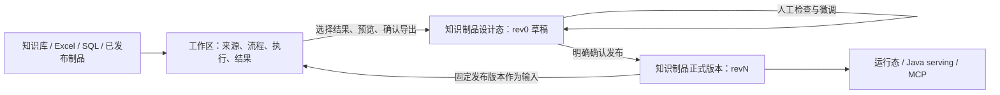

# 知识制品管理与制品工作区——需求规格及现有实现对照

> 编号：64；版本：V1.1 开发参考稿；日期：2026-10-28。
> 本文先梳理数据库底表，再分别描述两项独立需求：A.知识制品管理；B.制品工作区。最后定义工作区向制品草稿交付的接口与验收。
> 本次交付仅为需求文档，没有实施数据库迁移、修改业务代码或替换现有前端。
> 面向产品讨论和非开发读者，请先阅读 [65号功能说明通俗版](65-知识制品与制作工作台-功能说明通俗版-2026-10-28.md)。两份文档共用功能编号；本文保留源码、数据与实施约束，不要求产品读者通读。
> 最新版本安排：1.1.15 先收口知识制品本体，工作区统一延期 1.1.16。本版执行范围及原型对照以 [66号说明书](66-知识制品统一界面-1.1.15开发需求说明书-2026-10-28.md) 为准；本文工作区阶段不作为 1.1.15 的开发清单。

## 0. 核查基线与阅读规则

### 0.1 本次重新阅读的源码基线

| 基线 | 精确版本 | 本文如何使用 |
| --- | --- | --- |
| 表格制品发布标签 | `v1.1.15` → `9d221d2b109b58b268e4719b93f1a47f9a1ff625` | 可复现的原始发布源码基线，表格制作与制品生命周期已落地 |
| 可共享主分支基线 | `origin/master` → `24c43d4649efd327bef122d731a4431cc613cadd`（本文提交前） | 核查标签之后的制品权限、UI 与消费增量，其他开发者可拉取 |
| Wiki 实现分支 | `worktree-wiki-artifact-mvp` → `3075e5a303e2910795f52c7585f19740f1adf212` | Wiki 数据表、编译、编辑、发布、检索与 MCP 的分支实现事实 |

Wiki 工作树位于 `.claude/worktrees/wiki-artifact-mvp`。核查时有三个前端文件显示修改，其中有效文本差异为组件自动声明增加 9 行；本文不将其视为新的业务能力。主工作树原有的其他未提交修改也未计入本需求实施。

最初核查的本机 master HEAD 为 `872c445552e071994441187e391e9da1b0a233ff`；它比上列远端基线多一个检索缓存预热提交，与本需求涉及的制品代码无差异。本次文档提交不附带该无关代码，开发以包含本说明的最新远端 master 为基础。

**版本名称不能代替源码核查。** `v1.1.15` 标签本身没有 `visibility` 和 `mcp_key_open_artifacts`；当前 master 有这两项，迁移号为 `008`，注释仍沿用“1.1.15 权限模型”。用户实际部署包可能包含同版本号下的后续补丁，需核对包内迁移清单及构建信息，不能仅凭标签断言部署环境缺失功能。[E01][E02]

### 0.2 事实、目标和建议的区分

- **现有／复用**：上述指定源码中已有实现，不代表本轮重新完成了部署环境验收。
- **改造**：保留已有机制，补充接入方式、数据边界或缺失行为。
- **新增**：当前指定源码未实现的产品能力。
- **建议／待评审**：用于形成实现方案，未通过本文擅自确定物理表、技术依赖或产品政策。

61 号、63 号设计文档、用户提供的《知识制品 Pipeline 工作台需求文档》及交互原型是需求上下文；实现事实以源码为准。原型中的 SQL、模型、Agent 和发布均为模拟，不属于后端已有能力。附件中“不改 schema”等约束属于此前方案的阶段限制，不自动成为本轮长期架构约束。

## 1. 数据库底表：先明确现在有什么

### 1.1 数据归属总览

| 数据归属 | 保存什么 | 当前载体 | 本次处理原则 |
| --- | --- | --- | --- |
| 来源知识库 | 原始文档、内容版本、解析结果、结构化表、检索单元 | `asset_*` 相关表及对象存储 | 读取并固定来源版本，不由工作区覆盖原始资产 |
| 知识制品本体 | 制品身份、责任人、成员、草稿、正式版及消费开放 | `kb_artifacts` 等现有制品表 | 继续复用，保持独立生命周期 |
| 表格制品内容 | 列定义、业务行、来源账、质量问题 | `kb_table_columns`、`kb_table_rows` | 作为制品草稿／发布数据，不存通用工作区的所有中间结果 |
| Wiki 制品内容 | 整页 Markdown、元数据、页面引用、发布检索投影 | Wiki 分支的三张专有表 | 复用分支实现；完整页面与检索单元分开 |
| 制品工作区 | 输入范围、加工图、配置、运行、节点输出、导出目标 | 当前没有独立完整模型 | 新增业务归属，按需适配通用执行基础设施 |

这里有两种不同的“底表”：**数据库底表**指本节的持久化表；**工作区输入表**指来源转换后供算子处理的数据集。原文中的一张表、工作区中的中间表和正式表格制品也不是同一个对象。

### 1.2 现有制品通用表

| 表 | 关键字段／主键 | 已有职责 | 本轮复用与边界 |
| --- | --- | --- | --- |
| `kb_artifacts` | `artifact_id`；`domain_id`、`kind`、`title`、`description`、`usage_note`、`owner_user_id`、`status`、`current_revision`、`draft_open`、时间戳；master 增 `visibility` | 制品登记、生命周期及正式版指针 | 继续作为唯一制品身份；不要用一个虚拟制品代表整个工作区 |
| `kb_artifact_revisions` | `(artifact_id, revision)`；`schema_json`、`row_count`、摘要、发布人和时间 | 正式发布记录及结构快照 | 继续保存制品正式版；不充当工作区步骤历史。Wiki 用 `row_count` 存页数，UI 应按类型解释 |
| `kb_artifact_members` | `(artifact_id, user_id)`；`role=owner/editor/viewer` | 制品成员与角色 | 保留；不能直接替代独立工作区的成员关系 |
| `kb_artifact_batches` | `batch_id`、`artifact_id`、`channel`、文件／工作表、数量、创建者 | 制品导入批次；Wiki 分支扩展编译通道和详情 | 保留兼容；工作区普通中间步骤不伪装为制品导入批次 |
| `mcp_key_open_artifacts` | `(key_id, artifact_id)` | master 中每把 MCP 钥匙显式开放的制品子集 | 标签原版没有，master/Wiki 分支已有；复用现有授权模型 |

`status` 当前为 `draft/published/deprecated`；`current_revision=0` 表示尚无发布版。`draft_open` 表示是否检出待发布草稿，两者不是互斥状态：**已发布 r1 的制品可以同时有草稿**。[E01—E04]

现有创建事务会写 `kb_artifacts` 并加入 owner 成员行。服务层默认以当前用户为创建责任人；“自动采用工作区另一位负责人并给操作者 editor”不是现有创建接口已经支持的能力，需要交付桥接时补充授权和事务规则。[E03]

### 1.3 表格专有表与版本语义

| 表 | 实际结构 | 需要保留的规则 |
| --- | --- | --- |
| `kb_table_columns` | 主键 `(artifact_id,column_id)`；名称、类型、枚举、主键／索引标记、别名、active/dropped、列顺序 | 当前列定义是制品级活表，不含 `revision`；发布结构另存版本表 |
| `kb_table_rows` | 主键 `(artifact_id,revision,row_key)`；`data`、`provenance`、`conflicts`、展示顺序、更新信息 | `revision=0` 为制品行草稿；`revision>=1` 为发布快照；`row_key` 不能用展示行号代替 |

现有正式列类型为 `text/int/float/date/enum/bool`，没有正式 JSON 列类型。业务数据、来源账和质量问题分别存放，不应因为工作区需要文档 JSON 而全部混入 `data`。工作区的 JSON、列表和文档引用类型需要在导出时映射、展开或明确转成文本。[E01]

现有流程：[E03][E04]

1. 首次建制品后，尚无正式版；编辑或导入进入 rev0。
2. 已发布制品首次编辑时，`ensure_draft()` 将当前版行复制到 rev0，并置 `draft_open=true`。
3. 发布事务复制 rev0 到新版本，保存列定义快照，清除 rev0，推进正式指针。
4. 新版本号使用历史最大值继续递增，回滚后再次发布不会复用旧版本号。
5. 运行态列读取正式版 `schema_json`，避免设计态新增字段泄漏到运行态。
6. 回滚只修改正式版指针，不删除历史，不把历史内容覆盖进当前草稿。

**已经核实的限制：**

- 人工改单元格和导入写入同一份 `data`；追加导入同键 `UPSERT` 会覆盖整行业务值，没有字段级人工保护。[E04]
- `discard_draft()` 删除 rev0 行并关闭草稿，但不恢复 `kb_table_columns`；不能宣称“丢弃草稿已经撤销了所有列结构修改”。[E04]
- 回滚后再次编辑，`ensure_draft()` 只从当前正式指针复制历史行，不把该版 `schema_json` 恢复到活列定义。因此“回滚后的运行态”可使用历史结构，但“继续设计”不等于已经完整检出历史 schema；此项与完整结构草稿一起评审。[E03][E04]
- 当前 Excel 导入的批次、列修改、写行不是一个覆盖全程的导入事务；不能由“发布事务完整”推导所有导入制作动作都原子。[E05]
- 标题、描述和 `usage_note` 当前存放在制品登记表，元信息修改不等同新建内容版本；不能宣称说明卡所有字段都已经随每个正式版冻结。若要求用途说明也随版本回看，需要显式扩展版本元数据合同。[E03][E04]

这些是兼容与改造事项，不是重做已有表格制品的理由。

### 1.4 Wiki 分支新增和扩展的底表

| 表／变化 | 实际字段及约束 | 当前职责与复用限制 |
| --- | --- | --- |
| `kb_artifact_sources` | `id`、`artifact_id`、`kb_id`、`scope`、`fingerprint`、状态、创建信息；唯一 `(artifact_id,kb_id)` | 制品绑定知识库范围及脏标记；表名通用，但现有服务入口主要在 Wiki 下。它不是工作区多类型连接器表 |
| `kb_artifact_batches` 扩展 | 通道增加 `wiki_compile/sql_import`，新增 `details JSONB` | `wiki_compile` 已使用；`sql_import` 枚举存在不代表 SQL 接入已实现 |
| `kb_wiki_pages` | `(artifact_id,revision,page_key)`；标题、`page_type`、`frontmatter`、`body_md`、`origin`、`provenance`、`flags`、顺序及更新信息 | rev0 页面草稿、N 版页面快照；正文为整篇 TEXT，人工编辑器可复用 |
| `kb_wiki_page_links` | `(artifact_id,revision,from_page,to_page,anchor_text)`；`status=valid/broken` | 页间引用、断链及正反向链接。没有通用 `relation_type` 字段，不等于任意业务知识关系表 |
| `kb_wiki_page_units` | `(artifact_id,revision,unit_key)`；page_key、分块文本、`vector(1024)`、embedding 状态 | 正式发布后的检索投影；不是页面编辑内容，也不承载工作区 MD 中间结果 |

当前 `page_type` 只有 `topic/glossary/contradiction/open_question`。原型中的“命令／特性／操作”属于领域知识分类，不能直接当成数据库已支持的 `page_type`。首期可把它们放在 `frontmatter.knowledge_type` 等领域元数据中，页面存储类型仍按现有枚举映射；新增强语义页面类型需另行评审。[E08]

Wiki 发布将 rev0 的 pages 和 links 一起复制为正式版本。提交后再生成检索单元并启动 embedding；投影失败当前不会回滚正式发布，因此“已发布”和“检索就绪”必须分别展示。units 按版本保留，回滚不需要重新算向量。[E09]

现有绑定的 scope 为空目录数组时表示全库；一行可包含多个目录，但当前配置可变，编译按制品读取 active 绑定并写 rev0。这不等于已经具备工作区的独立运行、冻结来源清单和多类型连接器。

现有 Wiki 发布引用检查主要验证正文 `[[src:...]]` 是否属于草稿 provenance 中记录的 unit_ids 集合，没有重新查询源库 ACL、snapshot 或 unit 表；topic 页的来源非空门禁也不能概括成所有 page_type 的同一门禁。工作区执行／导出所需的来源校验须独立定义，不能声称已由现有发布校验完成。[E12]

### 1.5 可复用的来源与基础设施表

| 表／资源 | 已有能力 | 工作区用法及限制 |
| --- | --- | --- |
| `asset_documents` | 文件身份、库／目录、内容版本、源对象引用等 | 选择来源和形成文件清单，不能把当前文件指针误当固定历史版本 |
| `asset_document_snapshots`、`asset_document_snapshot_links`、`asset_build_document_snapshots` | 解析快照、源版本关联及 Build 使用的快照集 | 固定实际可用解析结果；不能混用另一内容版本的旧解析结果 |
| `asset_structure_nodes/edges` | 文档结构节点、边 | 按解析后的章节层级拆分；“L1”应按文档结构定义，不简单等同任意 Markdown `#` |
| `asset_structured_assets`、`asset_table_cells` | 源表引用、单元格及类型化值 | 表格盘点、源表规范化、抽取和聚合输入；只读来源 |
| `asset_retrieval_units_v2`、`asset_retrieval_embeddings_v2` | 库侧检索单元和向量 | Wiki 取材与聚类复用；不把工作区页面写回这些库侧检索表 |
| `asset_storage_objects` + MinIO | 对象定位、SHA-256、大小、状态、保留时间 | 登记工作区快照和检查点的对象；需要新增工作区归属和引用关系 |
| `mining_workflows`、`mining_workflow_versions` | 图草稿、草稿修订、冻结图、manifest、hash、算子目录版本 | 具有可借鉴／适配的流程版本模型；不是已支持独立工作区的证据 |
| `mining_runs`、`mining_workflow_node_events` | 运行、租约、节点 attempt、摘要、错误和事件 | 可评估复用执行基础设施，但现有字段、状态和处理链有文档挖掘语义 |

`asset_storage_objects.artifact_class` 当前受枚举约束，不能凭需要写任意新分类；`temporary` 也不能自动等同“可随时清理的工作区历史”。新增用途需明确归属、引用和回收规则。[E13—E17]

### 1.6 工作区需要补充的逻辑实体

下表是**逻辑持久化要求及物理映射候选**，不是本次新增表的 DDL，也不要求一次性照表名全部新建。技术评审必须为每个实体选定唯一权威存储，不能同时往两套表写不同的真值。

| 逻辑实体 | 至少需要保存的内容 | 复用／新增建议 |
| --- | --- | --- |
| 工作区 | workspace_id、domain_id、名称、责任人、状态、流程草稿及修订、时间戳 | 新增业务实体；不能复用 `kb_artifacts` 当工作区登记 |
| 工作区成员 | workspace_id、user_id、角色 | 新增成员关系；复用用户、域和角色检查工具，不继承制品成员表 |
| 来源连接与范围 | source_id、workspace_id、连接器类型、范围／查询配置、凭据引用、固定来源清单 | 新增工作区来源；`kb_artifact_sources` 保留制品依赖语义 |
| 流程冻结版本 | workspace_id、流程版本、完整图、算子／方法包版本、hash、创建人 | 优先评估适配现有 workflow 版本存储；不满足域归属／多输出协议时独立存储 |
| 一次执行 | run_id、工作区、冻结流程、输入清单、提交者、状态、取消、进度及租约 | 评估新 execution profile 后复用 `mining_runs`；不兼容则在同服务内独立建模 |
| 节点输出快照 | run_id、node_id、port_id、snapshot_id、内容类型、schema、粒度、数量、存储对象、hash、质量及血缘 | 新增明确输出索引；节点事件里的摘要不能替代完整结果 |
| 发布目标绑定 | workspace_id、稳定输出标识、artifact_id、上次导出快照、基准正式版 | 新增关系；它绑定的是输出目标，不是只按展示名称匹配制品 |
| 导出操作记录 | request_id、目标、输入快照、映射方案、预览令牌、目标并发令牌、状态及结果 | 新增或扩展现有导入记录；必须有可强约束的幂等身份 |
| 人工修订保护账 | artifact_id、内容身份、字段／页面、原生成依据、人工值／删除决定、适用修订、审核状态 | 表格需要新增保护机制；Wiki 可复用整页 origin 保护，但导出合并与修订版本仍需补齐 |

工作区图草稿中的节点、连线、画布坐标可以用 JSON 持久化，不要求一节点一张业务表。完整输出放对象存储，数据库保存索引；若未来需大规模分页／查询引擎，再按容量演进。

**执行存储复用的评审门槛：**现有 `mining_runs.input_path` 必填，stage 受限，`execution_engine` 当前仅 legacy/workflow；现有编译器和执行器有文档批处理、资产落库和 finalize 约束。若复用，要先增加独立 profile 与兼容约束，保证不会进入普通知识库 Build/readiness/finalize。不能把工作区 ID 随便塞进 `kb_id`、`input_path` 或 `metadata_json` 就宣布完成适配。[E15—E17]

### 1.7 五种版本身份不能混用

| 身份 | 解决什么问题 |
| --- | --- |
| 来源内容版本／解析 snapshot_id | 这次实际读取哪份原料和解析结果 |
| 流程草稿修订／冻结流程版本 | 这次实际采用哪套方法 |
| run_id + 节点输出 snapshot_id | 这次执行实际得到什么 |
| 制品草稿及并发令牌 | 编辑者现在准备交付什么，有没有被他人改过 |
| 制品正式 revision | 消费者现在使用哪一版经过发布的内容 |

流程历史、执行批次、画布分流和制品回滚是四件事。它们不能共用一个“运行分支”下拉框。

## 2. 两项独立需求与连接边界

### 2.1 需求 A：知识制品管理

管理有稳定身份的表格或 Wiki 制品，包括设计态、运行态、成员、版本、停用和 Agent 开放。既可以由用户手工创建，也可以由工作区导出自动创建。**本项目已经有主体实现，本轮以复用和补齐为主。**

### 2.2 需求 B：制品工作区

让用户在独立、可持续保存的工作区里选择来源，通过人工、确定性算子、模型和受控代码加工材料，观察中间结果，组合多输入、多输出，并把有效结果交给知识制品。**这是本轮主要新增能力。**

### 2.3 两边如何连接



- 一个工作区可以有多个独立来源和多张中间表，也可以产出多份知识制品。
- 首期一份表格制品对应一张正式逻辑表；一份 Wiki 制品对应一组页面及其内部引用。多表共同发布的复合知识包不在首期默认模型中。
- 工作区导出是“提交为新制品草稿／更新已绑定制品草稿”，不调用正式发布，不推进 `current_revision`。
- 进入运行态页签只是查看；只有制品内的发布动作才生成正式版本。
- 制品不用强制依赖工作区：现有 Excel 导入、手工建列加行、Wiki 手工页面编辑继续可用。
- 制品设计态负责定稿；构建流程在工作区管理。通过“返回构建工作区”关联，不在制品里再复制一套完整流程画布。

## 3. 需求 A：知识制品管理，按模块说明

### A01 制品列表、创建与类型

**现有：**列表、表格创建、元信息、域归属；master 创建路由仍固定 `kind=table`。Wiki 分支已放开表格／Wiki 创建和类型分流。[E03][E06][E07]

**本轮：**复用列表与身份模型；制品中心独立于工作台页签，显示草稿、已发布、待发布变更、停用、责任人及当前版。表格工作区直接对接现有表格制品服务，不等待 Wiki 全量合入；Wiki 自动创建必须以其分支类型支持合入并验收为前提，不另外造登记表。

**验收：**手工建表仍能独立完成闭环；工作区导出后出现在同一制品列表；数据库预留 kind 不被误认为主分支已有 Wiki UI。

### A02 设计态与人工微调

**现有：**表格列管理、行／单元格／批量编辑；Wiki 页面、frontmatter、正文、页面创建删除和人工保护。[E03][E06][E09]

**本轮：**继续使用类型专用编辑器。工作区导出的表格写制品 rev0，页面写 Wiki rev0；设计态不需要加载全工作区。表格修改不改变正式行，Wiki 正文保存后重算草稿引用。

需要补齐表格人工修订保护与完整结构草稿规则。未经该项改造，不能承诺重导不会覆盖人工值，或“丢弃草稿”已恢复全部列定义。

**验收：**正式 r1 可读时修改草稿，r1 不变；重跑导入之前能识别人工修改；未保存 Markdown 不能被悄悄忽略后发布旧正文。

### A03 发布与运行态

**现有：**用途说明必填、差异预览、乐观锁、发布事务、版本指针；Wiki 生命周期协作者按类型完成页面与链接发布。[E03][E04][E09]

**本轮：**发布权、版本号与事务继续由制品服务负责。工作区只传入候选内容，不传一个“直接生效”的标志。运行态与 Agent 只使用正式版，不消费工作区或 rev0。

Wiki 需要展示发布成功与检索投影状态的区别；投影失败可重试修复，不能显示成“正文发布没有成功”，也不能把向量未就绪冒充全通道就绪。

这里的“投影修复”是本轮待补能力。当前 status 可以在已有 pending 单元时重新触发 embedding，但投影完全失败、units 为零时，不会因此自动重建缺失投影。

**验收：**导出后无正式版、无 MCP 正式内容；制品确认发布后才出现 r1。已发布 r1 加新草稿时仍读取 r1。

### A04 版本、回滚、丢弃和停用

**现有：**版本列表、回滚拨指针、丢弃 rev0、停用和恢复；master 增加先停用后删除的门禁。[E04][E06]

**本轮：**保留这些机制。版本页按类型显示行数／页数和结构／页面差异；工作区执行记录不混入正式版本列表。发布后置索引／检索投影的状态必须可观察。

需要单独确认管理端停用后的历史读取政策：目前 Java/MCP 要求 `published`；管理 REST 的运行态数据读取按权限和正式指针，不等同 Agent 停服谓词。本文不把“停用后所有有权管理者也读不到历史内容”描述为现有事实。

**验收：**回滚后历史保留，草稿不被覆盖；回滚再发布的版本号继续递增；停用后 Agent 不可发现和查询。

### A05 责任人、成员、域内可见性与 MCP

**现有：**owner/editor/viewer、管理员旁路和当前域绑定检查；master 的 public 只向当前本域用户扩大读，写权限不扩大；钥匙需要显式开放制品。[E02—E04][E10]

**本轮：**复用权限判断，保留成员页与可见性设置。工作区导出默认责任人不能绕开创建权限；操作者、owner 与成员行保持一致。新制品默认 private，不自动勾选 MCP 钥匙，不复制整个工作区的成员列表。

**验收：**选择另一位负责人时，产生正确 owner 成员；操作者如需继续修改应获得明确 editor 授权。viewer 无设计和发布权限；本域公开不自动对 Agent 开放。

### A06 表格消费与 Wiki 消费

**现有：**表格通过 Java 服务做结构化行／聚合查询；MCP 发现和读取使用返回的 `artifact_ref`。Wiki 分支增加页面搜索、整页读取和链接单跳，仍走制品域权限。[E10][E11]

**本轮：**沿用同一制品消费面。工作区不能新增一个绕过制品发布和权限的“Agent 直接查中间表”入口。表格和 Wiki 保留各自查询／阅读方式。

需要补齐 Wiki 说明卡的 description/usage_note、发布差异展示及引用回原文体验，避免公共外壳复用但调用说明缺失。

### A07 Wiki 分支接入与定稿边界

**现有：**取材、聚类、目录确认、分批写作、引用检查、页面编辑、origin=manual 整页保护与发布检索均有分支代码。[E08][E09][E12]

**本轮：**优先保留现有编译入口作为兼容模板；将其工序逐步提取到工作区。制品设计态保留页面编辑和质量核查，编译主控制最终交给工作区，不能同时维护两套互不一致的编译状态。

现有发布 `schema_json` 写入 `toc: null`、`glossary: []`，阅读目录主要平铺；不能将设计稿的“确认后的目录树随版本定格”当作已实现。本需求要求补齐定版内容模型及阅读器显示。

## 4. 需求 B：制品工作区，按模块说明

### W01 工作区列表、创建、保存和权限

**新增。** 顶层“制作工作台”先提供工作区列表；可同时存在多个工作区，分别保存名称、用途、domain、责任人、成员、图草稿及当前查看位置。关闭或归档工作区不改变已发布制品。

用户可以从空白或模板创建工作区。正常保存流程即保存制作上下文，不要求另点“保存配方”才保留步骤。已有制品也可跳转到其绑定工作区，但不能仅凭制品 viewer 权限进入工作区读取全部原料。

**验收：**A 工作区的来源、配置、结果和未保存编辑不混入 B；刷新恢复已保存内容；多人修改用草稿修订校验，不按最后一次覆盖全部图。

### W02 来源接入与输入表

| 来源 | 目标用户操作 | 形成的输入与需要固定的信息 | 现有基础／新增点 |
| --- | --- | --- | --- |
| 知识库目录／文件 | 选同域、有权读取的库和范围 | 一行一文件；文件身份、目录、内容版本、解析 snapshot、文档内容引用、问题列表 | 复用库文件和解析资产读取；新增工作区适配器、范围持久化与输入清单 |
| 知识库已抽取表格 | 盘点、搜索、选择表格 | 一行一源表或展开成源业务行；保留 table_ref、坐标／源行引用 | 复用 structured assets/cells；新增规范化、分类、合并算子 |
| Excel | 上传、选工作表和表头 | 一行一工作表记录；原文件对象、工作表、原行索引和类型 | 复用解析／映射函数；将当前制品绑定预览流程适配为工作区输入，不能先污染制品 |
| SQL | 选受控只读连接和表／查询 | 记录查询、参数、schema、读取时刻及可获得的一致性版本；没有快照能力时明确说明 | 当前无完整通用接入；新增连接器、凭据引用、分页与限额，非 `sql_import` 枚举即用 |
| 已发布知识制品 | 选择有权读取的制品及正式 revision | 表格数据／Wiki 页面及引用；记录 artifact_id 和固定正式版 | 复用消费与版本读取；新增工作区来源适配，首期不读取别人的制品草稿 |
| 空白表／人工材料 | 定义字段、录入／粘贴 | 稳定行 ID、人工来源、结构及内容快照 | 编辑组件可复用；新增工作区数据归属 |

来源列表是整个工作区可使用的原料，不意味着所有来源必须合成第一张表。文档输入的 JSON／长文本可按需加载；前端分页只是查看方式，不决定加工范围。

选择范围与确认执行分开。缺权限、缺可用解析、无表格、内容版本不匹配、读取失败均显示原因，不静默跳过。读取知识库现有解析资产；重新挖掘应是显式上游操作。

现有表格管理接口显式读取历史 revision 时要求设计角色。工作区需要新增受控的制品来源适配：选择当前可读正式版后冻结引用，后续复读再次校验来源权限；不能直接给 viewer 放开现有管理端历史接口。普通读者是否允许任意选历史正式版，列入权限政策评审。

### W03 三类数据集与来源契约

所有算子交换有类型的数据集，不把任意结果都伪装成二维字符串：

| 数据集 | 最小内容 | 稳定身份与表现 |
| --- | --- | --- |
| `TableDataset` | 字段定义、类型、行、行含义、来源、质量问题 | dataset/output 身份 + 稳定 row_id；表格编辑器 |
| `DocumentSet` | 页／文档 key、标题、frontmatter、完整 body_md、来源、质量问题 | 文档身份独立于顺序；页面清单 + Markdown 阅读／编辑 |
| `RelationSet` | 关系 ID、from/to 稳定引用、关系类型、方向、依据与校验状态 | 关系列表 + 知识关系图；不是加工图的连线 |

共用信封还应包含内容类型、schema 版本、数量、run/node/port 来源、内容摘要和存储引用。展示名称可以改，稳定 port_id／dataset 引用不能随之变化。

行号只用于显示；章节拆分需要保留文档和章节定位；聚合需要保留所有原行来源。业务主键缺失时可使用内部行 ID 探索，但正式合并／发布前必须明确稳定匹配策略。

### W04 算子目录、配置和版本

**适配＋新增。** 可复用 `HandlerRegistry` 的 type/version 分派思想和纯函数；新增工作区算子契约：输入端口、允许的数据集类型、基数、参数表单、输出端口、输出结构、执行方式、校验、错误及来源映射。

目标算子覆盖以下组别；下一批可启用的来源、算子与交付范围以附录 B.1 为准，不能把下表直接当作一次迭代的全量任务：

| 组别 | 用户能力 | 关键规则 |
| --- | --- | --- |
| 确定性表加工 | 筛选、保留／删列、改名／类型、排序、去重、拆分、展开、透视、分组、关联／合并 | 处理完整输入；明确一对多／多对一和身份／来源转换；不改上一步快照 |
| 结构化源表整理 | 表名分类、同类表合并、字段归一、单位转换 | 名称相似度不冒称语义聚类；重复字段／主键冲突进入问题账 |
| LLM 加列／抽取 | 选择输入列、Jinja 模板、输出字段与类型，样本预览、全量执行、失败行重试 | 复用 LlmTaskClient Chat 任务；校验输出，保留 task_id、模板和模型配置 |
| Agent 辅助编程 | 用自然语言要求生成脚本，审阅、试跑、保存转换 | 保存脚本及版本；后续执行已保存代码，重新生成属于修改方法 |
| 人工调整 | 修改值、增加记录、人工判断 | 保存针对稳定记录的修改，不自动归纳成面向所有未来输入的规则 |
| Wiki 构建 | 分类取材、目录生成／确认、写页、提取引用、质量检查 | 复用现有 Wiki 工艺；输出 DocumentSet/RelationSet，暂不强迫所有知识对象化 |

模型、确定性代码、Agent 代码和人工操作可以组合；对每步均展示输入、规则、输出和问题。不能因为配置保存成 JSON 就声称方法能够适用任何新资料。

### W05 多输入、多输出与流程图

**新增通用执行协议。** 默认下一步可引用当前输出，但用户必须能选择其他来源或历史输出。同一节点支持命名的多个输出，后续按端口精确引用。

```text
文档底表 → 抽取产品信息 ─specs→ 关联库存 → 选型表
                       └compat→ 配套关系表
SQL 库存表 ─────────────────→ 关联库存.right
```

多表输入不全是纵向合并：关联、并集、分组、横纵转换各有不同规则。节点表单要展示左右表、字段映射及关联方式。输出数量和字段可以在探索期推断，但要确认结构后再稳定用于重跑；出现新列、缺列、类型变化时明确报告。

执行按依赖拓扑排序，不按列表顺序或画布坐标。禁止环路、缺输入、端口类型不兼容、歧义写入；动态重接后仍应正确执行、恢复和追溯。流程分流只表示不同处理路径，不自动产生制品新版本。

### W06 流程画布、内容视图和节点表单

**新增交互外壳，复用内容组件。** 一个工作区只有一份图与选中上下文，提供两种视图：

- **流程视图**：画布看来源、算子、命名输出与依赖；节点卡片只显示摘要。右侧配置当前节点；下方看当前输出。
- **内容视图**：主要空间给表格或文档，侧边导航保留节点／输出。适合人工检查、加列和微调。
- **聚焦内容**：放大结果区域，隐藏次要面板；返回后保留节点、输出及位置。

点击节点或输出仅切换查看，不调用模型。切换视图保留同一个 output_ref。右侧表单随节点变化；“查看已保存步骤”与“配置待执行变更”有明确状态。修改参数后旧输出标“上次成功结果”，不能把旧数据标成新配置已完成。

Markdown 输出用页面目录／清单、正文阅读／编辑器；关系输出提供关系列表和知识关系图。**流程图表达加工依赖，知识关系图表达页面／对象关系，两种图不能混在一起。**

### W07 预览、全量执行、恢复和更新批次

预览使用独立临时结果，只读，不改变已保存输出，也不能直接导出为正式全量数据。样本运行与全量运行有不同 run 标记；已执行结果通过快照准确回看，不承诺模型重跑逐字一致。

执行前冻结流程、配置及输入版本。支持执行当前节点、必要上游、选定输出的依赖子图及整个工作区；界面明确具体范围。上游内容或方法变化后，下游保留旧快照并标记待更新，重新执行前不能导出为当前有效结果。

一次新资料更新创建独立 run，不把一整套重复节点追加到画布。查看旧 run 固定其输入和输出；恢复不能依赖页面内存或进程内缓存。取消、失败行重试、检查点和租约应与现有任务基础设施适配。

`LlmTaskClient.submit_chat` 已支持任务 ID、模型、预期输出和幂等键；工作区应形成包含输入内容、模板／脚本、输出 schema、算子版本和模型配置的幂等身份，避免误用上一轮结果。[E18]

执行状态与可导出性分别判断。以下是目标语义，需在新 profile 中与现有数据库状态映射，不直接向旧 CHECK 写入新值：

| 对象／状态 | 含义 | 首期导出规则 |
| --- | --- | --- |
| 运行成功 | 所有要求的分支执行完成 | 逐个核验所选输出及其依赖，不能只看运行总状态 |
| 运行部分成功 | 某些独立分支成功，另一些失败 | 成功且依赖闭合的独立输出可导出；失败分支不得混入 |
| 节点／输出部分成功 | 如 1000 行中 5 行模型失败，完整覆盖尚未形成 | 首期禁止把成功的 995 行冒充完整结果导出，须重试补齐 |
| 样本、运行中、失败、取消 | 不是完整的已完成输出 | 不可导出；检查点仅用于恢复和观察 |
| 已完成但过期 | 上游或规则已变，仍可回看旧快照 | 当前制作上下文不可当作最新输出导出；明确选定历史冻结运行则按历史输入重新预览 |

筛选规则主动排除记录不等于漏处理。质量账记录输入覆盖、过滤数量、失败数量和待处理范围。同一 Wiki 的页面及引用等有一致性要求的输出应归为一次就绪组，组内未全部完成时不能只导出其中一部分。未来如允许部分结果例外交付，必须单独定义显式确认与缺失披露，首期不开放该例外。

### W08 人工修改、血缘和质量

工作区人工修改保存为新快照或显式人工调整步骤；旧结果不可变。只改这一条记录与修改通用规则分开；模型可以建议规则，用户确认后才应用到未来输入。

记录展开／聚合时保留原始依据；选中某个输出，只展示该输出的实际祖先链，不把整个工作区都当成来源。页面编辑后应重新解析确定性引用，再使相关检查节点待更新，重跑不能恢复被人工删除的旧链接。

需区分：输入缺失、模型失败、类型错误、主键冲突、断链、来源变化、人工值与新生成值冲突。失败和空值不能伪装为成功结果；导出门槛由目标类型及规则决定。

### W09 Wiki 配置包与现有编译的迁移

现有 Wiki 编译是绑定 artifact_id 的固定工艺，产物直接写 rev0，运行状态在 batches.details，prepare 材料部分保存在 `_PREPARE_CACHE`。它不能直接成为“无制品也能独立运行”的工作区算子。[E12]

迁移要求：保留取材、聚类、目录提示词、生成、引用校验等可复用部件；把输入改为显式数据集，把输出先写工作区快照。编译器不再拥有正式发布权，也不因预览创建目标制品。

领域构建配置包包含：知识类型及取材规则、方法／提示词版本、页面模板、输入输出结构、身份和引用规则、检查规则、必要脚本。SKILL 可以承载方法说明和示例；结构校验、身份、引用解析、权限和恢复必须由平台执行。

不同知识类型可用不同编纂方法。不要把云核的“命令—特性—操作”固定为平台类型；也不要把任意业务关系直接塞进现有 Wiki 引用边表。通用语义对象层不作为工作区首期前置条件。

### W10 来源权限、SQL 与代码执行边界

工作区成员关系、来源读取权、目标制品写权限分别校验。拥有工作区编辑权不自动获得源知识库权限；拥有制品读权限也不自动获得源库原文读取权。用户撤权后新执行必须重新验证；历史快照的继续保留／可读政策需评审。

SQL 使用受控只读连接，配置只保存凭据引用；查询有超时、结果量及分页限制。Agent 脚本在隔离执行环境运行，仅访问明确输入并写声明输出，受 CPU、内存、时间和网络能力限制。Jinja 使用受限模板环境，不能调用任意平台对象。

首期复用现有服务进程、存储与模型通道，不因工作区新增一个独立部署的表格服务。容量与调度通过实际环境测试确定；原附件的文件数、64MB 快照、十万行等值只是此前方案约束，不构成已实现性能承诺。

## 5. 工作区到知识制品：独立交付契约

### X01 指定输出与自动创建草稿

用户选择一个或多个已完成、非样本、未过期的输出，填写／确认目标名称、目标类型、责任人和用途。默认责任人为工作区负责人；服务端验证其同域、有效身份及受委托创建权限。现有创建接口默认操作者 owner，指定另一位 owner 是新增能力。

- 首次交付：创建 `kb_artifacts`、owner 成员及必要 editor 成员，写入目标 rev0，再保存 output→artifact 绑定和导出记录。
- 新制品默认 private，MCP 开放集为空；不把整个工作区成员、来源库 ACL 或全部原料都自动复制进制品。
- 已有制品：验证目标同域、类型、写权限和并发令牌；不擅自改 owner、可见性、成员或 MCP 开放。
- 输出 port_id 与 artifact_id 稳定绑定。改输出展示名不改目标身份；删除／改接输出需显式处理原绑定，不能按名字猜目标。

导出成功显示“草稿已创建／已更新”和“前往设计态”。不会调用 publish，不写正式 N 版，不拨正式指针，不在此时启动 Wiki 正式检索投影。

### X02 表格和 Wiki 的导出适配

| 输出 | 写入现有制品草稿时的规则 |
| --- | --- |
| 表格 | 字段映射、现有类型转换、主键策略和冲突预览；首次可建列，更新已有目标默认映射既有 schema，不隐式删列／改主键 |
| Markdown 集合 | 映射 title、page_key、page_type、frontmatter、body_md、来源及 flags，写 Wiki rev0；页面与引用在一致的草稿事务内处理 |
| 页面引用关系 | 与同一 Wiki 页面集合一起验证和导出为 valid/broken 链接；不是独立正式 Wiki 内容身份 |
| 通用关系集 | 可以显式转换成表格制品；任意关系类型作为 Wiki 原生持久化能力需另行扩展，不能冒用 anchor_text |

不能为了复用 Excel 导入而把任意数据集先落成临时 Excel 再上传。应抽取／复用规范化、类型转换和写草稿能力，保留现有向导作为独立入口。

**更新必须声明集合语义，不能仅声明主键冲突策略。** 导出方案需固定“这是全量快照还是增量批次”、哪些旧记录归本输出维护、源中消失项如何处理，以及人工新增项如何处理。

| 交付模式 | 更新范围与缺失项处理 | 本需求建议 |
| --- | --- | --- |
| 全量快照提交 | 当前输出代表绑定生产范围的完整候选集合；缺失的既有机器记录列为移除候选，不能直接清空目标。人工新增、受保护或来源身份不明的记录进入保留／待核对项 | 工作区首次建制品采用此模式；更新已有目标在保护能力完成后开放 |
| 按业务键合并 | 只新增／更新本批命中记录，目标中未命中的行保留；显式删除决定单独提交 | 兼容既有追加导入思想，作为后续工作区交付选项；必须明确选择，不从文件名猜测 |
| 纯追加 | 仅新增记录，已有键碰撞拒绝，不自动更新旧记录 | 需要独立场景与身份规则后再开放，不作为默认行为 |

Wiki 全量更新也要限定本绑定的生成范围：本次不再生成的 machine 页列为删除候选，manual 页／人工新建页不得被默认删除；页面删除及其引用变化一起预览。当前编译服务的 UPSERT／origin 保护不能直接视为这套集合语义已完成。

所有模式的预览分别列出新增、修改、保留、移除候选和待核对项。用户确认的是完整导入方案，不是只确认一个“覆盖重复主键”的开关。目标列结构变化另行审核，删除行不等于删除列。

### X03 导出预览、并发、幂等和失败恢复

1. 预览固定输入 snapshot、字段映射／合并规则与目标状态，展示数量、样例、冲突和人工修订影响；不修改目标数据或创建正式版本。
2. 已有未发布草稿时，首期默认阻止自动覆盖，提供前往设计态处理的入口；后续可增加显式合并审阅。
3. 预览后目标 `updated_at`、正式指针、草稿状态或输入快照变化，要求重新预览。权威检查在写入事务内完成。
4. 使用唯一 request_id／幂等键；重复提交返回同一导出结果，不能多建制品、多写版本或重复导入。
5. 单个目标的创建、成员初始化、草稿内容和导出记录需要一致提交；跨数据库部署须采用明确的幂等状态和补偿，不能声称有跨库事务。
6. 多目标导出可以逐目标事务并返回完整成功／失败列表；失败只重试未完成目标。首期不承诺所有制品跨库原子创建。
7. 工作区删除／归档不会级联删除已发布制品；绑定失效、目标停用或删除必须明确提示，禁止自动换一个同名目标。

### X04 保留人工修订与再生成

现有表格单份 data 不能支持无条件的“人改优先”承诺，需要新增可查询的人工修订账。Wiki 的 origin=manual 保护整页是已有基础，但不等于跨工作区导出、回滚后重导都已受保护。

**人工保护是更新已有制品的前置能力。** 在无法识别正式版人工修订的阶段，只开放首次创建新制品草稿；不能因为目标目前 `draft_open=false` 就认为它没有人工修改并允许覆盖。已有草稿检查与已发布人工修订保护是两道不同门禁。

目标规则：

- 制品设计态修改和保护记录在同一草稿事务内保存；只有正式发布后，这些修订才成为后续生成合并的正式基线。
- 丢弃草稿同时丢弃其未发布保护记录；正式旧版保护记录保留。
- 工作区再生成提交候选内容，按稳定业务身份／字段 ID／page_key 匹配已确认修订，保持未被人工修改的字段继续更新。
- 原生成依据变化、记录消失、字段删除／改型、页面身份冲突时，进入待核对，不能静默覆盖，也不能把旧人工值机械套到新对象。
- 人工删除形成明确决定，不能下次同步自动复活；释放保护是显式动作。
- 正式版本应能追溯当时采用的生成结果及人工修订；回滚后的再生成以当前有效版本的保护政策为准，不复活后来已回退的修订。

## 6. 公共实现与服务职责

| 层／模块 | 现有基础 | 本次职责 |
| --- | --- | --- |
| `kb-ui` 制品页面 | ArtifactDetail、Rows/Schema/Members/Versions/Publish；Wiki 分支的 Editor/Reader | 制品本体继续维护；工作台复用内容组件，不复制生命周期逻辑 |
| 新工作区前端 | 当前仅独立交互原型 | 工作区列表、图形／内容双视图、节点表单、端口选择、执行预览与导出 |
| `knowledge_mining/mining/kb` 制品服务 | ArtifactService、ArtifactDB、导入服务、WikiLifecycle/WikiDB | 目标权限、草稿写入、发布／回滚及人工修订保护的权威服务 |
| 工作区应用服务 | 尚无独立完整实现 | 工作区／来源／快照／运行组织，编排算子，调用制品草稿交付服务 |
| `workflow` 公共部件 | 图模型、注册器、manifest/hash、编译校验、执行记录机制 | 抽取可复用部件；为 typed dataset 和多输出增加专门协议／profile |
| `llm_service` 与 LlmTaskClient | Chat、embedding、任务状态、幂等、重试通道 | 执行模型请求，不承担工作区身份或制品发布决策 |
| Java serving、MCP | 制品发现、权限过滤、表格查询；Wiki 分支的页面搜索／读取／链接 | 继续消费正式版本；不感知全部工作区加工细节 |

现有编译器要求固定挖掘节点和 `mining_finalize.result`，`WorkflowGraph` 当前只有一个最终 output；运行时处理 DocumentState 文档批次。虽然节点定义已有 input_slots/output_slots、边已有 fromSlot/toSlot，仍不能据此声称已支持通用多结果工作区。[E16][E17]

接口组织建议：保留当前 `/api/artifacts` 本体接口，新建独立工作区资源前缀，提供 sources、graph、runs、node outputs、exports 等能力。具体 URL 属于技术设计，不能把建议接口写成当前已存在的 API。前端沿用现有 mining 域代理和登录身份传递方式。

## 7. 复用／新增／改造总清单

| 能力 | 判定 | 说明 |
| --- | --- | --- |
| 制品登记、草稿／正式版、发布／回滚、成员、表格消费 | 复用 | 是现有主体，不重新建设第二套制品系统 |
| public/private、钥匙开放子集、删除前停用 | 复用 master 增量 | 不误归到原始 v1.1.15 标签 |
| Wiki 页／链接／检索单位及生命周期 | 复用分支，先完成合入 | 按代码和真实环境验收，不能只凭 63 号设计稿 |
| Excel 解析、字段映射、类型转换 | 复用函数，改造入口 | 分离工作区输入与制品导入，消除先写目标的耦合 |
| 知识库范围选择、解析／表格／切片读取、对象存储 | 复用并适配 | 固定版本、校验权限和来源，不重新解析同一原料 |
| 工作区登记、成员、来源、多工作区管理 | 新增 | 与制品身份／成员独立 |
| 数据集类型、命名端口、输出快照与血缘 | 新增 | 表格、Markdown、关系有不同展示和持久化契约 |
| DAG 画布、内容视图、节点表单、失效传播 | 新增 | 同一执行模型，不能做成互不一致的两套流程 |
| 通用算子执行、流程版本、任务调度 | 改造基础设施＋新增 profile | 当前挖掘 Runtime 不能原样运行工作区 |
| SQL 来源、Agent 受控脚本执行 | 新增 | 原型演示和枚举预留不算实现 |
| Wiki 固定编译工艺变成可配置工作区模板 | 提取和改造 | 保留兼容入口与已有质量规则，逐步迁移状态和输出 |
| 工作区输出→自动建制品草稿、绑定责任人和目标 | 新增桥接 | 复用制品服务，绝不把导出等同正式发布 |
| 表格人工修订保护、导出三方合并 | 新增／改造 | 当前 UPSERT 会覆盖人工值；Wiki 只有整页保护基础 |
| Wiki 目录定版、发布 diff、说明卡、回原文 | 改造／补齐 | 当前分支仍有可见接缝，详见附录 |

## 8. 交付顺序与兼容要求

| 阶段 | 可以独立交付的内容 | 不应出现的回归 |
| --- | --- | --- |
| A 基线整理 | 核准部署包、确认 master 增量、合入并验收 Wiki 制品本体 | 不改变既有表格发布／查询、ACL 和正式引用协议 |
| B 工作区最小闭环 | 多工作区、来源底表、确定性算子、快照、画布／内容视图 | 不借用制品 rev0 存全部中间过程；不开全平台 SQL／脚本权限 |
| C 首次草稿交付 | 表格输出映射、首次自动创建／绑定草稿、责任人、幂等和并发检查 | 未具备保护机制前不更新已有制品；不自动发布、不改变 MCP 开放 |
| D 智能加工与受控更新 | LLM 加列、试跑重试、受控脚本、人工修订保护、更新已绑定目标 | 先完成保护与集合语义再开放更新；不把模型输出冒充确定结果 |
| E Wiki 工作区 | 取材／目录／写页／引用算子、三类内容展示、Wiki 草稿交付 | 不把页面塞入库侧检索表；不取消现有 Wiki 阅读和版本能力 |

SQL 连接器、Agent 执行沙箱的实施顺序由能力与部署约束单独确定，不以本阶段原型已有按钮为实现完成标准。正式上线涉及的 schema／迁移按现有 manifest、安装／升级及镜像一致性规范评审，本轮不编写迁移脚本。

## 9. 核心验收场景

| 编号 | 场景 | 必须满足的结果 |
| --- | --- | --- |
| T01 | 原有 Excel→编辑→发布→Agent 查询 | 仍可独立使用，无需先创建工作区 |
| T02 | 多工作区保存、关闭、重新打开 | 来源、图、已保存配置和输出正确恢复，工作区间不串数据 |
| T03 | 多来源分别输入 | 知识库、SQL、已有制品不是强行拼成第一张表；各有版本引用 |
| T04 | 关联节点左右输入切换 | 表单、图连接和真实结果一致；缺字段／重复键按规则报错 |
| T05 | 一节点两个输出 | 输出各有稳定端口和名称，可分别查看、连接、导出 |
| T06 | 流程／内容／聚焦切换 | 保留当前节点与输出；右侧配置随选择变化 |
| T07 | 改参数→预览→执行 | 预览不改原结果且不可编辑；执行才保存新输出并使下游待更新 |
| T08 | 重新接出合法但非列表顺序的 DAG | 执行和恢复均按依赖排序，不读旧上游，不误报成功 |
| T09 | 回看历史结果 | 不调用模型，准确读取该次输入与输出；不能混入另一运行结果 |
| T10 | LLM 试跑、失败、仅重试失败行 | 样本不当全量导出；成功行不重复调用；任务与失败原因可追溯 |
| T11 | Wiki 页面清单、正文、关系切换 | 同一结果有合适展示；流程边与知识关系不混淆 |
| T12 | 修改 Markdown 引用后保存／重跑／恢复 | 人工正文和关系一致，已删除引用不被无故恢复 |
| T13 | 导出两份产出，指定责任人 | 自动建两份独立制品草稿与正确成员，默认私有、无 MCP 开放 |
| T14 | 导出后查看运行态／Agent | 没有首次正式版；只能在设计态检查候选内容 |
| T15 | 制品内填写说明并发布 | 生成正式 r1；以后编辑草稿不改变 r1 |
| T16 | 已有草稿、目标并发变化、重复导出 | 阻止覆盖／要求重新预览；相同请求不重复建制品 |
| T17 | 人工改单元格或页面后重新生成 | 保留匹配修订；依据变化、身份消失时进入核对 |
| T18 | 回滚、再发布、停用、恢复 | 正式指针与历史正确，版本号不撞号，Agent 停用谓词生效 |
| T19 | 工作区成员无来源权、制品读者无原文权 | 不能通过预览、快照或来源链接越权读取 |
| T20 | Wiki 发布后投影失败或向量未就绪 | 正式内容与检索状态分别可见，允许修复且不假称全通道可用 |
| T21 | SQL 删除记录、筛选排除旧行、Wiki 不再生成一页 | 按已确认的交付模式处理，分别预览移除候选与人工保留项，不静默全删或永远保留旧机器数据 |
| T22 | 1000 行中 5 行失败／另一独立输出完整成功 | 部分行结果不得冒充完整输出；独立完整分支按依赖与就绪组检查，不被粗粒度总状态误判 |

真实 LLM 内容质量、语料遗漏、SQL 一致性与规模、脚本隔离及部署后 Web→mining→serving→MCP 冒烟必须在真实环境验收。原型交互测试或模拟客户端不能替代这些验收。

## 10. 实施前需要确定的事项

1. **部署基线**：用户当前“1.1.15”实际包包含哪些后续补丁和迁移，不能只凭标签／界面名称判断。
2. **执行存储选型**：独立工作区 profile 复用 mining workflow/run 表还是同服务独立表；需验证域归属、状态约束、多输出和租约兼容，禁止双权威存储。
3. **物理数据库边界**：工作区、制品、对象索引实际是否同库；据此确定导出事务与补偿方案。
4. **责任人代理创建政策**：工作区 editor 是否可按 owner 预设授权，以工作区责任人为新制品 owner；不能把前端默认值当成服务端授权。
5. **表格结构草稿**：是否在首期补齐 schema 的检出／丢弃／恢复；在补齐前，不能向用户承诺完整撤销。
6. **人工保护粒度**：表格建议字段级，Wiki 首期整页；墓碑、解除保护和版本关联需明确实现，不能仅凭标记字段完成。
7. **多生产者绑定**：一份制品是否允许多个工作区作为并行生产者；建议首期只保留一个当前主要构建绑定，转移由 owner 明确操作。
8. **来源撤回与策展开放**：区分原文读取、制品交付和强制撤回，明确撤权后历史工作区快照保留／访问政策。
9. **首期容量**：明确文件、行列、快照、LLM 并发和代码预算，以实际运行测试定限额。
10. **领域类型／关系**：哪些放 frontmatter，哪些需要新增强约束模型；首期不隐式扩大为完整本体平台。

上述事项不阻止理解产品范围，但决定数据库迁移和多服务实施方案。当前交接状态为：**需求评审稿可读，技术实施前需要完成架构与兼容评审，不应直接按原型开始多服务编码。**

## 附录 A：重复核查的代码证据

下面路径均相对项目根目录；同一单元格内省略重复目录的文件名沿用该格已给出的同类目录。`T` 表示 v1.1.15 标签，`M` 表示 master 基线，`W` 表示 Wiki 基线；完整 SHA 见第 0 节。可用 `git show <SHA>:<path>` 重现，不依赖工作树未来是否归档。

| 编号 | 基线与主要证据 | 核查用途 |
| --- | --- | --- |
| E01 | T/M：`databases/kb/schemas/017_kb_artifacts.sql` | 六表、制品状态、列和行类型；比较 tag/master 的 visibility 与钥匙表差异 |
| E02 | M：`databases/migrations/core/20261019_008_artifact_visibility_key_open.sql` | public/private 与钥匙开放子集确切增量 |
| E03 | M：`knowledge_mining/mining/kb/services/artifact_service.py`，创建 262、发布 414、行视图 636；`knowledge_mining/mining/kb/routes/artifacts.py` 创建路径 | 角色、当前用户 owner、发布门禁、运行／草稿读取、master kind 固定 table |
| E04 | M：`knowledge_mining/mining/kb/db_artifacts.py`，创建 99、发布 428、回滚 561、discard 660、ensure_draft 689、UPSERT 1035 | rev0、正式快照、事务、指针、列草稿限制和人工覆盖 |
| E05 | M：`knowledge_mining/mining/kb/services/artifact_import_service.py`，parse_upload 303、execute_import 613 | Excel 当前制品绑定、预览、映射、批次和写入链路 |
| E06 | M：`kb-ui/src/views/artifacts/ArtifactDetailView.vue`；`kb-ui/src/components/artifacts/ArtifactRowsPanel.vue`、`kb-ui/src/components/artifacts/ArtifactSchemaPanel.vue`、`kb-ui/src/components/artifacts/ArtifactPublishDialog.vue`、`kb-ui/src/components/artifacts/ArtifactVersionsPanel.vue` | 既有四页签、编辑、发布、回滚与元信息／权限 UI |
| E07 | W：`kb-ui/src/views/artifacts/ArtifactsListView.vue`、`ArtifactDetailView.vue`；`knowledge_mining/mining/kb/routes/artifacts.py` | Wiki 创建类型分流、共用四页签及专有编辑／阅读 |
| E08 | W：`databases/kb/schemas/017_kb_artifacts.sql`、`databases/kb/schemas/018_wiki_artifacts.sql`、`databases/migrations/core/20261021_010_wiki_artifacts.sql` | batches 扩展、来源绑定唯一约束、Wiki 三表和 page_type 限制 |
| E09 | W：`knowledge_mining/mining/kb/services/wiki_service.py`，WikiLifecycle 151、发布 165、回滚 212、页面编辑 442；`knowledge_mining/mining/kb/db_wiki.py` 发布段 | 发布／投影分离、版本单位保留、人工页和链接更新 |
| E10 | M：`agent_serving_java/src/main/resources/mapper/ArtifactToolMapper.xml` 83、354；`agent_serving_java/src/main/java/com/coremasterkb/serving/structure/ArtifactQueryService.java`；`mcp_server/server.py` 的 art_ 分支 | 正式版查询、published 谓词、成员／public／key 过滤与返回引用 |
| E11 | W：`agent_serving_java/src/main/java/com/coremasterkb/serving/structure/ArtifactWikiSearchService.java`、`agent_serving_java/src/main/java/com/coremasterkb/serving/structure/InternalArtifactController.java`、`agent_serving_java/src/main/resources/mapper/WikiArtifactToolMapper.xml` | Wiki 说明卡、搜索、整页／链接读取；卡片用途说明字段缺口 |
| E12 | W：`knowledge_mining/mining/kb/services/wiki_compile_service.py`、`knowledge_mining/mining/kb/services/wiki_compile_pages.py`、`knowledge_mining/mining/kb/services/wiki_compile_prompts.py`、`knowledge_mining/mining/kb/db_compile_inputs.py`、`knowledge_mining/mining/kb/wiki_clustering.py` | 固定编译、batch.details、prepare 内存缓存、提示词、来源读取及整页保护 |
| E13 | M：`databases/asset_core/schemas/002_asset_core_postgresql.sql`、`008_object_storage_foundation_postgresql.sql`、`013_retrieval_assets_v2_staging.sql`、`014_a1_source_locators.sql`、`015_a2a3_section_scope_typed_cells.sql` | 文件／快照／解析对象／单元格／来源定位基础 |
| E14 | M：`databases/mining_control/schemas/001_mining_workflow_postgresql.sql` | workflow 草稿、冻结版本、manifest 和全局名称约束 |
| E15 | M：`databases/mining_runtime/schemas/002_mining_runtime_postgresql.sql`、`005_mining_workflow_runtime.sql`、`007_mining_run_kb.sql`、`008_mining_run_leases.sql`、队列相关迁移 | run 的必填字段、stage/engine、事件、租约与 KB 归属 |
| E16 | M：`knowledge_mining/mining/workflow/core.py`、`knowledge_mining/mining/workflow/graph.py`、`knowledge_mining/mining/workflow/handler_registry.py`、`knowledge_mining/mining/workflow/compiler.py` | slots、单一最终 output、固定 finalize 校验、注册器边界 |
| E17 | M：`knowledge_mining/mining/workflow/runtime.py`、`knowledge_mining/mining/workflow/executors/document_executor.py`、`knowledge_mining/mining/workflow/executors/global_executor.py`、`knowledge_mining/mining/api/app.py` | 文档批次执行、全局收尾、域任务分派；不是现成工作区 Runtime |
| E18 | M：`knowledge_mining/mining/infra/llm_task_client.py`，submit_chat 98 | 任务提交、expected_output_type、model、幂等键、状态／失败语义 |

### 附录 A.1 文档与实现不能混记的 Wiki 接缝

- `db_wiki.py` 发布快照实际含 `toc: None`、`glossary: []`；确认过的目录树尚未完整成为发布目录。
- Wiki diff 的 changed 元素为页面形态，共用发布对话框仍有按表格行／列渲染的部分；版本面板仍有“行数”措辞。
- Wiki 卡片 record 与表格卡片字段不同，description/usage_note 尚未完整统一。
- 阅读器来源角标主要复制 unit_id，尚未形成完整的点击回原文体验。
- `_PREPARE_CACHE` 在进程内，重启可能使等待目录确认的编译失效；工作区要求持久化执行输入，不能继承这一恢复限制。

### 附录 A.2 现有材料与本需求的关系

- 61 号是表格 Excel MVP 的来源，保留其制品本体和兼容规则，不把它的阶段性非目标当永久限制。
- 63 号是 Wiki 分支设计来源，存储／生命周期方向可复用，是否完成以分支代码为准。
- 用户提供的 Pipeline 文档提供了完整输入加工、历史快照、分支、LLM、发布前检查等上下文；本文把其中的“制作”归入独立工作区，并把“正式发布”归还已有制品本体。
- 当前交互原型用于解释视图、端口、多数据类型和交付关系；其中模拟实现不能替代本文对真实服务、schema 和权限的要求。

## 附录 B：开发 Agent 充分性审查与实施补充

### B.0 审查结论与使用方式

V1.0 已足够理解产品目标、核对现有能力和做技术方案，但不能据此让多个独立 Agent 直接实现完整工作区：来源／算子的首批范围、操作副作用、局部运行结果归属、重复导出以及人工冲突仍有不同解释。V1.1 补充以下统一规则。

| 工作 | 当前是否足够 | Agent 应如何开始 |
| --- | --- | --- |
| 核查既有制品、分配模块、制定兼容方案 | 足够 | 按 A/W/X 编号及源码基线执行，不重做现有生命周期 |
| 明确 B/C 的产品交付与测试故事 | 本附录补齐后足够 | 采用 B.1 范围、B.2 操作和 B.3 算子口径 |
| 决定物理表、运行 profile、数据库事务边界 | 仍需技术方案 | 先完成第 10 节相应评审，不把逻辑候选直接变成任意 DDL |
| SQL、Agent 脚本执行、完整再生成保护 | 不能仅凭目录直接编码 | 分别补连接器、隔离执行、保护合并的任务级方案与测试，再启用 |

本文不是最终接口／迁移设计。每个编码任务开始前，Agent 必须拿到该任务的输入输出样例、现有组件清单、选定存储、权限入口和对应验收；缺少一项时先做方案，不靠猜测补全产品政策。

### B.1 下一批范围与阶段退出条件

下表是本稿建议的默认拆分，完整目标仍以正文 A/W/X 为准。它解决“先做哪一小包”的歧义，不取消 SQL、脚本或 Wiki 目标。

| 阶段 | 可启用的能力 | 不启用的能力与前置 | 退出条件 |
| --- | --- | --- | --- |
| A 基线 | 表格制品兼容核查；Wiki 本体另线合入验收 | 表格 B/C 不依赖 Wiki 完整合入；Wiki E 依赖其本体验收 | 表格 T01、T15、T18 对应回归通过；Wiki 按其页面／检索另行验收 |
| B 表格工作区 | Excel、已有解析的知识库文档；表格数据及文档结构列；选择／改名、筛选、拆章节、透视、按键左／内关联；多输入输出和双视图 | 不开放生产 SQL、Agent 代码、通用关系制品、Wiki 编纂；已有制品来源先限当前可读表格正式版并经受控适配后启用 | T02—T09 中上述范围通过，关闭／重开、改输入后重跑仍正确 |
| C 首次草稿交付 | 完整表格输出首次创建制品草稿、责任人、绑定和重复请求处理 | 不更新任何已绑定目标的新内容；尚未发布的已绑定制品也属于已有目标 | B.3 固定材料完整走通制作→导出草稿→设计态→发布→MCP；T13—T16 的首次创建部分通过 |
| D 智能加工与受控更新 | LLM 加列／抽取及失败重试；人工保护通过后，再启用新结果更新已绑定制品 | SQL 与代码执行分别验收后才开放；不能用“目前没有打开草稿”替代保护能力 | T10、T17、T21、T22 及绑定更新部分通过；未完成保护时保持更新入口关闭 |
| E Wiki 工作区 | 页面、关系、目录／编纂工序及 Wiki 草稿交付 | 依赖 Wiki 本体和 typed document/relation 协议，不反向阻塞 B/C | T11、T12、T20 和 Wiki 草稿／发布闭环通过 |

未列入当前批次的能力，不显示成可执行按钮；可显示为明确的“尚未开放”，不能用模拟成功响应代替真实实现。原型允许模拟，生产功能不允许。

### B.2 统一操作矩阵

| 操作 | 使用什么 | 保存／改变什么 | 不允许的副作用 |
| --- | --- | --- | --- |
| 保存节点配置 | 当前表单与工作区草稿修订 | 保存配置，推进工作区草稿修订，相关结果标待更新 | 不启动计算，不把旧结果改名为新结果，不产生制品正式版 |
| 样本预览 | 当前表单候选配置 + 明确选定的上游快照 | 产生隔离的、只读的样本执行结果；不保存节点配置 | 不修改当前完整输出，不编辑预览值，不导出样本 |
| 全量执行当前节点 | 已保存配置 + 固定输入快照 | 创建新执行／输出快照，成功后按 B.4 推进当前结果 | 表单未保存时先要求保存，禁止隐式一边保存一边执行 |
| 全量执行工作区 | 提交时冻结的已保存流程及输入 | 按依赖执行需要的节点；保留每次结果和错误 | 有未保存配置时明确提示，禁止悄悄只运行旧配置 |
| 保存人工修改 | 当前已保存完整输出或制品设计态 | 工作区生成新修正快照；制品生成待发布修订；按各自归属保存 | 不写样本、不覆盖历史快照、不立即改变正式版 |
| 导出制品草稿 | 已完成、未过期、符合门禁的输出快照及确认方案 | 创建／更新目标草稿、稳定绑定和导出记录 | 不改变工作区结果，不调用正式发布 |
| 正式发布 | 已保存的制品草稿、说明、差异及目标并发令牌 | 生成正式版本、更新正式指针，执行已有后置投影 | 未保存正文必须先保存或明确放弃；不能发布编辑器旧内容 |

自动保存可以作为 UI 实现，但必须展示保存成功／失败并遵守同样的修订和冲突规则。“保存”不等于执行或发布。预览采用的候选配置应可查看，与已保存配置明确区分。

允许提供明确标为“保存并执行”的组合按钮：先校验并保存配置，再提交执行。保存失败时不执行；执行失败时保留已保存配置，旧输出标为上次成功结果并显示失败原因。不能仅用一个含义不清的“保存”按钮暗中调用模型。

### B.3 B/C 最小算子与固定验收材料

| 算子 | 参数与结果口径 | 错误和来源规则 |
| --- | --- | --- |
| 选择列／改名 | 列 ID 和顺序显式选择；改名目标不重复；至少保留一列 | 未知字段／重名明确报错；行身份和来源不变 |
| 筛选 | 参数含字段、操作和类型化值；普通比较不匹配 null，空值单独使用“为空／不为空” | 缺字段或值无法转换则不执行；保留命中行的身份和来源 |
| 拆一级章节 | 输入已解析文档结构，按声明的一级章节展开；一文件可生成多行 | 无该级章节的文件进入问题清单；新行身份由来源文档和章节定位组合，不用展示行号 |
| 按标题转列 | 显式选择文档分组键和标题列；每个分组／标题要求唯一；缺失章节填空 | 重复标题首期报错，提示先归一／聚合，不自动保留任意一段；每列仍保留章节来源 |
| 按键关联 | 首期左关联和内关联；左右键显式选择；右键要求唯一；null 键不匹配 | 右键重复报错，不做未声明的一对多膨胀；未匹配左行在左关联中保留，补充列为空；合并双方来源 |

固定材料：产品表为 `P1/3000W、P2/2000W、P3/1200W`，库存表为 `P1/5、P3/0`。左关联得到 3 行，其中 P2 库存为空；内关联得到 2 行；左关联后筛选功率至少 2000W 得到 P1、P2 两行。右表重复加入 P1 时，关联必须失败且原结果不变。

B/C 端到端验收使用这组固定数据：保存工作区、执行、切换视图、关闭重开，得到同样结果；导出两行结果后只出现制品草稿；填写说明并发布后，运行态及获授权 MCP 查询才得到两行。真实 LLM 效果不混入这组确定性验收。

### B.4 局部执行、快照与当前结果

每次执行固定图修订、算子配置和各输入的 snapshot_id。复用此前运行的上游结果时，必须显式记录该快照引用及其权限／有效性，不能在执行途中读取“此刻最新输入”。

执行有效修订只反映节点逻辑、参数、输入和输出合同的变化。拖动画布位置、缩放或切换视图不改变执行语义，不应因此使数据过期或重新计算。

同一节点的一致性输出组写入全部内容并校验成功后，才一起提交就绪索引；其中一个输出失败时，不能把该组的其余输出当成完整产物。不同独立分支仍按 W07 分别判断。

旧快照不被覆盖。任务结束时，仅当工作区图修订与输入仍匹配，才推进当前成功结果；若用户期间改了配置，结果保留到原运行记录并标过期。旧任务迟到不得覆盖新配置的当前结果。

人工修改工作区结果也生成新快照，记明修改人和原快照，使下游待更新；不能只改浏览器表格、重开后恢复成旧结果。查看历史执行时固定其图与快照，不推进当前指针。

### B.5 首次导出、重试和再次导出

- **首次／更新按目标身份判断**：绑定目标已经创建后，新内容交付就是更新，即使它尚未首次发布。
- **重试按 request_id 判断**：同一请求返回原结果，不重新创建；相同 ID 携带不同内容或方案应拒绝。
- **重复点击按导出指纹判断**：相同输出快照、映射与目标的请求，即使换了请求 ID，也返回已绑定目标及原草稿入口，不重复写入。
- **丢弃草稿不解除绑定**：用户再次提交相同数据，仍使用原制品身份；属于重新写草稿，按当前阶段的更新门禁处理，不自动另建同名制品。
- **C 阶段门禁**：只允许首次创建和无副作用的重复请求查询。绑定后的新写入须等待 D 的更新能力；UI 提示原因，不留静默覆盖通道。
- **已有制品草稿未处理**：阻止覆盖，进入制品检查／发布／丢弃；以后若建设合并审阅，应另行定义明确行为。

### B.6 人工冲突的判定与放行

保护项记录原生成快照、稳定内容身份、字段／页面身份、原值、人工值／删除决定，以及所依赖来源的摘要。表格按字段保护，但首期如果来源只能追溯到整行，则该行依据变化时保守进入待核对；Wiki 按整页依据变化判断。不能仅比较整份文件是否改名，也不能只比较新值是否恰好与旧值相等。

待核对项未裁决，不允许提交目标草稿。审核动作明确区分“保留人工值”“采用新生成值”“确认删除”“解除人工保护”，并记录操作者和依据；人工删除适用相同规则。正式发布、丢弃草稿、回滚按各版本采用相应保护记录。

第 10 节的存储、事务与代理创建政策仍需方案评审。上述产品默认规则可用于编写任务合同，但不能由 Agent 自行推导一个尚未批准的数据库或外部授权方案。
